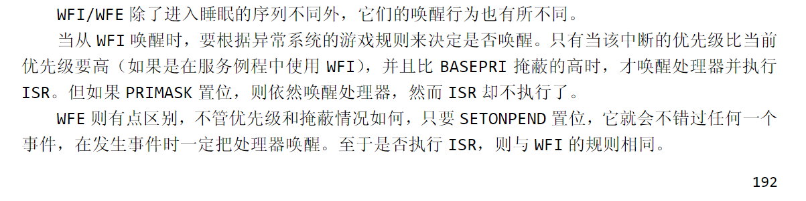
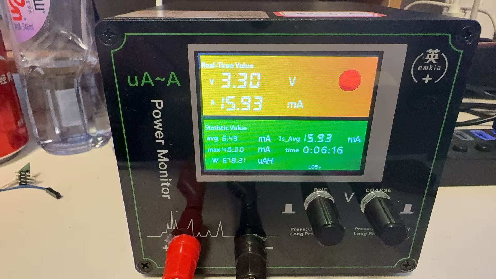
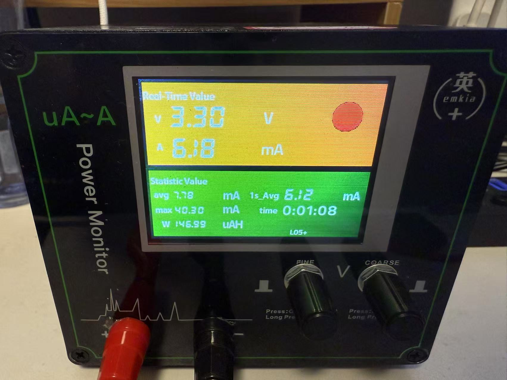
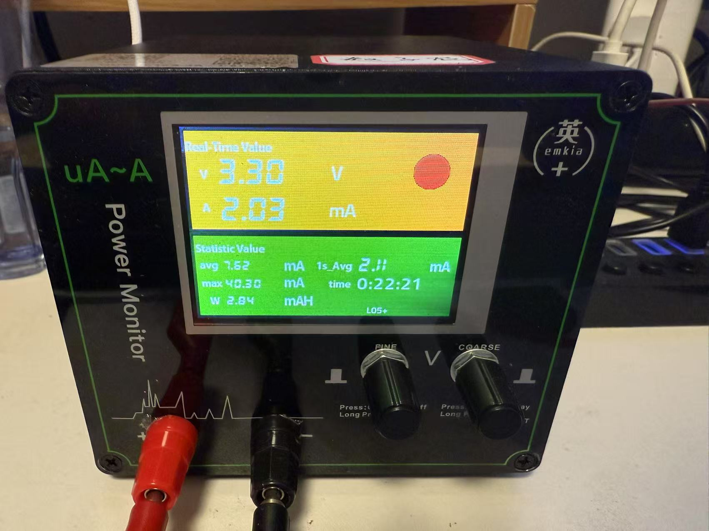
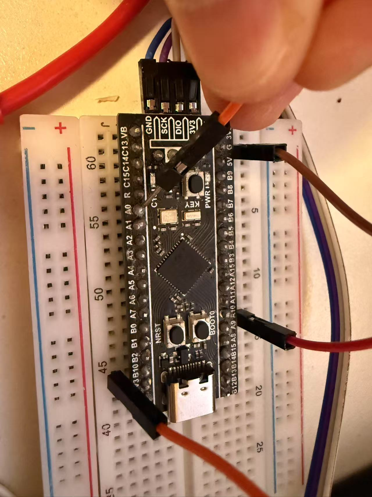
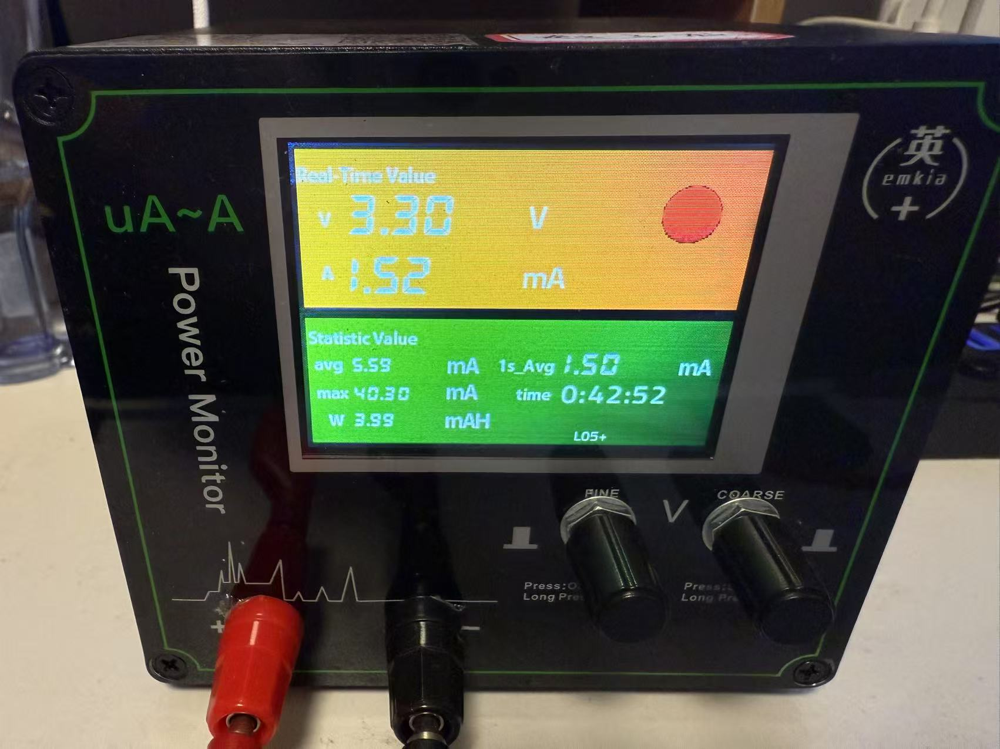

# 30\_STM32\_进入低功耗模式

# 0 学习目标

1. 实现STM32的睡眠模式\(SleepMode\)

2. 实现STM32的停机模式\(StopMode\)

3. 实现STM32的待机模式\(StandbyMode）

# 1 知识学习

1. 了解VCC/VDD/VSS/VBAT 

2. 理解ST电源管理系统

3. 完成STM32睡眠模式代码编写

4. 完成STM32停机模式代码编写

5. 完成STM32待机模式代码编写

# 2 实验内容

## 2\.1 了解**芯片供电管脚**

**STM32芯片主要通过引脚VDD从外部获取电源**，**在它的内部具有电源监控器用于检测VDD的电压（电压过低CPU无法启动）**，以实现复位功能及掉电紧急处理功能，保证系统可靠地运行。


图1


图2


图1，2为WeAct开发板电路图

**VCC** ： **C=circuit** 表示电路的意思, 即接入电路的电压

**VDD** ： **D=device** 表示器件的意思, 即器件内部的工作电压;

**VSS** ： **S=series** 表示公共连接的意思，通常指电路公共接地端电压

**VBAT** ：当使用电池或其他电源连接到VBAT脚上时，**当VDD 断电时，可以保存备份寄存器的内容**

**和维持RTC的功能**。如果应用中没有使用外部电池，VBAT引脚应接到VDD引脚上。

录制:STM32供电和三种工作模式简介

录制文件：https://meeting\.tencent\.com/crm/KPYk4E3W7c

密码：H7DS

## 2\.2 电源管理系统

STM32的电源管理系统主要分为以下三个部分：**VDDA供电区域**；**VDD供电区域和1\.2V供电区域**；**后备供电区域**


VBAT 供电路径 → **RTC \+ LSE \+ 备份寄存器**

VDD → **I/O、唤醒逻辑、内核、数字外设**

VDDA → **ADC、PLL、温度传感器等模拟模块**

名词解释：

- **VDD、VSS**

D=device 表示器件的意思,即器件内部的工作电压;S=series 表示公共连接的意思，通常指电路公共接地端电压。VDD、VSS是芯片工作的电压端口，主要为I0供电以及通过稳压器为内核、内置数字外设、存储器等供电。简单来说就是为所有芯片的数字电路部分供电。


- **VDDA、VSSA**

A=analog 表示模拟的意思，是模拟电路部分的电源。主要为ADC模块以及其他的模拟电路部分\(复位电路、PLL等\)供电。ADC使用一个独立于VDD的电源供电，过滤和屏蔽来自印刷电路板上的毛刺干扰，ADC的电源引脚为VDDA，以及独立的电源地VSSA。即使不使用ADC功能，也需要连接VDDA，强烈建议VDD和VDDA使用同一个电源供电。比如因为连接着复位电路，如果不连，芯片无法下载代码。


- **VREF\+、VREF\-**

REF=referencee，VREF表示ADC的外部参考电压，如果有VREF\-引脚\(根据封装而定\)，它必须连接到VSSA，VREF\+的输入范围为2\.4\~VDDA\(一般接VDDA\)。如果没有VREF\+和VREF\-引脚，他们在芯片内部与ADC的电源\(VDDA\)和地\(VSSA\)相连。


- **VBAT**

使用电池或其他电源连接到VBAT脚上，当VDD断电时，可以保存备份寄存器的内容和维持RTC的功能。VBAT脚也为RTC、LSE振荡器和PC13至PC15供电这保证当主要电源被切断时RTC能继续工作。切换到VBAT供电由复位模块中的掉电复位功能控制。如果应用中没有使用外部电池，VBAT必须连接到VDD号脚上。


### **\(1\) 供电区域电压：**

- VDD=2\.0\~3\.6V:V DD引脚为l/0引脚和内部调压器供电。

- VSSA，VDDA=2\.0\~3\.6V:为ADC、复位模块、RC振荡器和PLL的模拟部分提供供电。使用ADC时，VDDA不得小于2\.4V。VDDA和VSSA 必须分别连接到VDD和VSS

- VBAT=1\.8\~3\.6V:当关闭VDD时，\(通过内部电源切换器\)为RTC、外部32kHz振荡器和后备寄存器供电。

### **\(2\) 备份域电路**

STM32的LSE振荡器、RTC、备份寄存器这些器件被包含进备份域电路中，这部分的电路可以通过STM32的VBAT引脚获取供电电源，**在实际应用中一般会使用3V的钮扣电池对该引脚供电**。


### **\(3\) 调压器供电电路**

在STM32的电源系统中调压器供电的电路是最主要的部分，**调压器为备份域及待机电路以外的所有数字电路供电**，其中包括CPU内核、 数字外设以及RAM，调压器的输出电压约为1\.2V，**因而使用调压器供电的这些电路区域被称为1\.2V域**。


调压器可以运行在"运行模式"、“停止模式"以及"待机模式”。在运行模式下，1\.2V域全功率运行；在停止模式下1\.2V域运行在低功耗状态，1\.2V区域的所有时钟都被关闭，相应的外设都停止了工作，但它会保留内核寄存器以及SRAM的内容；在待机模式下，整个1\.2V域都断电，该区域的内核寄存器及SRAM内容都会丢失\(备份区域的寄存器及SRAM不受影响\)。


### \(4\) ADC电源及参考电压

为了提高转换精度，STM32的ADC配有独立的电源接口，方便进行单独的滤波。ADC的工作电源使用VDDA引脚输入，使用VSSA作为独立的地连接，VREF引脚则为ADC提供测量使用的参考电压。

录制: ⁡⁤‌​‍⁤⁤⁢‬⁢​‌⁢‍⁢​​‍⁢⁤‬‌⁡​‬‌⁣​⁣​⁤⁢⁣⁤‬​⁣​‬‬⁤讲解STM32的电源域

录制文件：https://meeting\.tencent\.com/crm/NXQJb9ar43

密码：6ZPD

## 2\.3 STM32的低功耗模式

STM32 提供了 3 种低功耗模式，以达到不同层次的降低功耗的目的。我们可以打开参考手册搜索低功耗找到对应文档说明，下图为STM32F411XX参考手册Low\-power章节截图：


图1\. 英文手册

图2\. 中文翻译

录制: 三种低功耗模式

录制文件：https://meeting\.tencent\.com/crm/2ZBWwB8Za9

密码：EEH6

注意：**STM32F411xx参考手册**在导入DFP时已经保存在keil安装目录中，这里还有官方的**HAL驱动使用手册**和**CubeMX使用指南**等可参考。


### 2\.3\.1 不同模式对比

## 2\.4 **WFI和WFE指令**

**WFE（Wait For Event）和WFI（Wait For Interrupt）**是两种在STM32微控制器中用于低功耗模式的指令，关于它们更详细的区别可查阅《CM3权威指南》了解，它们的主要区别在于它们的行为和使用场景:


- WFE（Wait For Event） WFE指令会让CPU进入低功耗模式，并且在一个事件（**通常是外设的中断事件**）发生时自动唤醒。这个事件可以是外部中断、定时器事件、UART接收事件等。当CPU执行了WFE指令后，它会进入低功耗状态，直到一个预期的事件到来。一旦事件发生，CPU会自动从低功耗模式中唤醒并继续执行下一条指令。


- WFI（Wait For Interrupt\) WFI指令同样会让CPU进入低功耗模式，**但它的唤醒条件是任何中断的发生**。与WFE不同，WFI不等待特定的事件，而是等待任何中断请求。这意味着，无论哪个中断被触发，CPU都会从低功耗模式中唤醒。WFI指令通常用于不确定何时会到来的中断，或者在多个中断源中等待任何一个中断的情况。


以下摘自《CM3权威指南》：



录制文件：https://meeting\.tencent\.com/crm/lJGJ7yx4ae

密码：SHWG


## 3\.1 STM32的进入Sleep模式

录制: STM32CubeMX环境搭建

录制文件：https://meeting\.tencent\.com/crm/NQDJGd0Jaa

密码：FBZN

[01\-sleep\_V1\.7z](图片和附件/01-sleep_V1.7z)

Sleep模式前



Sleep模式后




```C
// 进入Sleep模式
void Enter_Sleep_Mode(void) {
    HAL_SuspendTick();   // 挂起Systick（可选）
    printf("go into Sleep\r\n");
    HAL_PWR_EnterSLEEPMode(PWR_MAINREGULATOR_ON, PWR_SLEEPENTRY_WFI);
    printf("exit from Sleep\r\n");
    HAL_ResumeTick();    // 恢复Systick
}

void main（）
{
    while()
    {
        printf("go into Sleep in 3s\r\n");
        printf("go into Sleep in 2s\r\n");
        printf("go into Sleep in 1s\r\n");
        //Enter_Sleep_Mode()；
    }
    
}


```

录制: ⁡⁤‌​‍⁤⁤⁢‬⁢​‌⁢‍⁢​​‍⁢⁤‬‌⁡​‬‌⁣​⁣​⁤⁢⁣⁤‬​⁣​‬‬⁤进出Sleep模式

录制文件：https://meeting\.tencent\.com/crm/lJGJVeL9a4

密码：DYPZ

[01\-sleep\_V2\.7z](图片和附件/01-sleep_V2.7z)

如果发现无法下载了，先按BOOT按键，再按下NRST按键，然后松开NRST按键，不松BOOT按键，进行下载。

## 3\.2 STM32的进入Stop模式




```C
// 配置低功耗调压器
void Enter_Stop_Mode(void) {
    HAL_SuspendTick();
    HAL_PWR_EnterSTOPMode(PWR_LOWPOWERREGULATOR_ON, PWR_STOPENTRY_WFI);
    HAL_ResumeTick();
    SystemClock_Config();  // Stop唤醒后需重新配置系统时钟
}

void main（）
{
    while()
    {
        printf("go into Sleep in 3s\r\n");
        printf("go into Sleep in 2s\r\n");
        printf("go into Sleep in 1s\r\n");
        //Enter_Stop_Mode()；
    }
    
}


```

录制: ‌‌‌进入‌STOP模式‌​‍⁤⁤⁢‬⁢​‌⁢‍⁢​​‍⁢⁤‬‌⁡​‬‌⁣​⁣​⁤⁢⁣⁤‬​⁣​

录制文件：https://meeting\.tencent\.com/crm/NgY8a5pJ04

密码：RDPR

## 3\.3 STM32的进入Standby模式

```C

void Enter_Standby_Mode(void) {
    HAL_PWR_EnableWakeUpPin(PWR_WAKEUP_PIN1);
    __HAL_PWR_CLEAR_FLAG(PWR_FLAG_WU); 
    HAL_PWR_EnterSTANDBYMode();
}

void main（）
{
    if (__HAL_PWR_GET_FLAG(PWR_FLAG_SB))
    {
        printf("from Standby ！\r\n");
    
        HAL_Delay(1000);
    
        __HAL_PWR_CLEAR_FLAG(PWR_FLAG_SB);
    }
    else
    {
        printf("normal startup\r\n");
    }

    while()
    {
        printf("go into Sleep in 3s\r\n");
        printf("go into Sleep in 2s\r\n");
        printf("go into Sleep in 1s\r\n");
        Enter_Standby_Mode();
    }
}


```

[01\-standby\-mode\.7z](图片和附件/01-standby-mode.7z)

> 通过网盘分享的文件：01\-standby\-mode\.7z
> 
> 链接: https://pan\.baidu\.com/s/1j0RkPLP\_Va81NuXNsVyl4w?pwd=4hr9 提取码: 4hr9 
> 
> 

录制: ⁡⁤‌​‍⁤⁤⁢‬⁢​‌⁢‍⁢​​‍⁢⁤‬‌⁡​‬‌⁣​⁣​⁤⁢⁣⁤‬​⁣​‬‬⁤进入Sleep模式

录制文件：https://meeting\.tencent\.com/crm/2rEAOLqw69

密码：R5WD

注意:

1、工程的优化等级记得设置为0，否则无返回值的void Enter\_Standby\_Mode\(void\)函数可能会被优化。

2、Standby模式必须要Wakeup\-pin（PA0）上升沿才能触发，由于weact开发板上的按键是接地的，所以需要用一根杜邦线去尝试给与一个上升沿信号。


可以用下图的方式，触碰3V3到PA0






# 3 实验效果


## 代码：


# 4 面试问题准备


# Q\&A

1. 怎么检测是否进入低功耗？

用电流计去测量，观测工作电流降低了多少毫安，功率降低了多少毫瓦。


# 附件\[1\]

