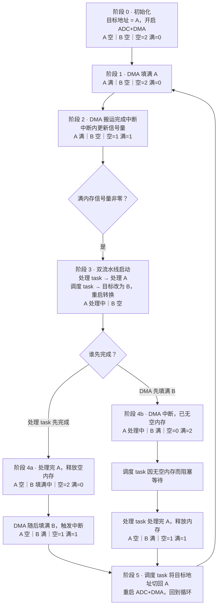
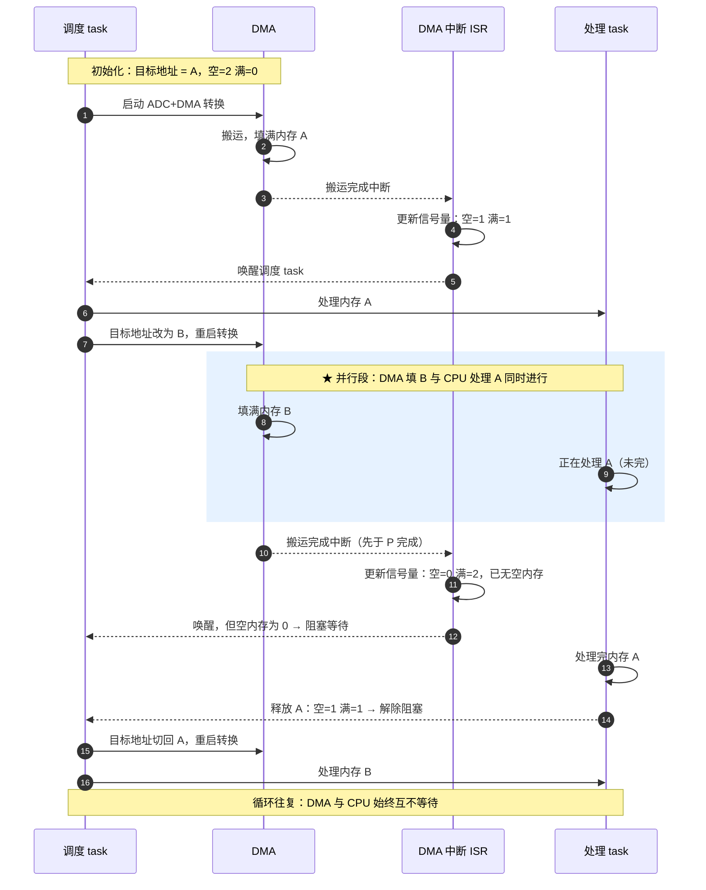

# ADC 采集和 DMA 传输模式

> ADC 负责把连续的模拟信号变成离散的数字值，DMA 负责把这些值搬运到内存里。两者配合，可以让 CPU 从"采集 + 搬运"中彻底解放出来。

## 一. ADC 原理和应用

### 1. ADC 在做什么？—— 将模拟世界"数字化"

画翻页书就是一个典型的 ADC 转换过程。

#### 1.1 采样

假设要画一本"小鸟飞行"的翻页书，你需要先把每一帧都画好，然后以**固定的节奏**翻动，才能呈现小鸟飞行的效果。

这里有两个要点：**每一帧的质量**要保证，**翻动的节奏**必须均匀。

类比到电信号：每次采样出的结果需要精准，采样必须匀速。而"采样的精准度"又引出了 ADC 另外两个关键步骤——量化和编码。

#### 1.2 量化

给翻页书上色时，由于你的颜料笔有限，你没法完美画出真正的小鸟，只能把小鸟身上的颜色归入现有的颜料笔中。

这就是量化——把连续的电压值"四舍五入"到有限的范围中，因此必然产生误差（量化噪声）。

#### 1.3 编码

计算机无法直接理解模拟世界，所以还需要编码：给每只颜料笔贴上一个二进制标签。

> **小结**：用固定的节奏匀速采样，再经过量化和编码变成二进制，最后"翻动"——模拟世界里的翻页书，就完全在数字世界中复刻出来了。

### 2. SAR-ADC 怎么猜出那个数字？—— 用二进制砝码称重

ADC 为了追求效率和质量，在"量化"这一步上大作文章，演化出了许多类型。单片机中被广泛使用的是 **12 位精度的 SAR-ADC（逐次逼近型 ADC）**。

SAR-ADC 的做法，就像用一套二进制砝码称东西。

假设量程是 0~15g，你手上有四个标准砝码：**8g、4g、2g、1g**（对应二进制的每一位）。现在要称一个约 10g 的物体：

| 步骤    | 操作              | 天平结果        | 含义              | 该位 |
| ------- | ----------------- | --------------- | ----------------- | ---- |
| 第 1 位 | 先放最大的 8g     | 物体更重        | 8g 不够，肯定保留 | **1** |
| 第 2 位 | 再加 4g（共 12g） | 砝码更重        | 4g 多了，拿掉     | **0** |
| 第 3 位 | 换加 2g（共 10g） | 一样重/物体更重 | 2g 刚好，保留     | **1** |
| 第 4 位 | 再加 1g（共 11g） | 砝码更重        | 1g 多了，拿掉     | **0** |

**结果：`1010`（十进制 10）**——四个回合就精准锁定。

映射到 ADC 上：

- **量程**由所有砝码的重量之和决定（满量程），对应 ADC 中由**参考电压**决定；
- **分辨率**由最小砝码决定（这里是最小的 1g），对应 ADC 中由**位数**决定——12 位意味着能把满量程分成 2¹² = 4096 份。

### 3. ADC 的三种工作模式：扫描 / 连续 / 非连续

这三种模式共同回答一个问题：**ADC 一次触发到底转换多少通道？转换完又干什么？**

#### 3.1 扫描转换模式（Scan Conversion Mode）

控制：ADC 是否按照配置的通道序列，对多个通道依次转换。

- **Enable**：每次触发（软件或硬件）都会按照规则通道（Regular Channels）中配置的顺序，对所有通道完成一次完整的转换序列。适用于需要同时采集多个模拟信号的情况，例如多传感器数据采集、数据监测等。
  - 同时启用连续模式：完成一次序列后立即开始下一次，形成连续的循环；
  - 同时启用非连续模式：通道序列会被分成若干组，每次触发只转换一组；
  - 两者都不启用：完成一次序列后停止，等待下一个触发事件。
- **Disable**：只对配置的一个通道进行转换，没有"通道序列"的概念。每次触发只转换一个通道，简单高效，适用于单一传感器读取等简单应用。

#### 3.2 连续转换模式（Continuous Conversion Mode）

控制：ADC 转换完成后是否立即开始下一次转换。

- **Enable**：转换（单个通道或整条序列）完成后不停止，立即重新开始。你会看到数据寄存器（DR）里的数据一直在刷新，EOC 标志位不断产生，可以通过**轮询**或**中断**随时取走最新数据。
- **Disable**：转换完成一次后停止，等待下一个触发事件。

#### 3.3 非连续转换模式（Discontinuous Conversion Mode）

控制：ADC 是否把通道序列分批转换。

- **Enable**（前提：Scan 模式也需 Enable）：ADC 将通道序列分成若干个小组，每组大小由**非连续数目（Discontinuous Number）**参数确定，范围是 1~8。每个触发事件**只转换一个小组**，然后停止，等待下一个触发事件——每次非连续转换都需要新的触发。
- 适用于需要在多个触发事件下分批次采样的场景，例如实时控制系统中，希望每个控制周期只采样部分通道（而不是全部），以减少 CPU 负担。

> **举例**：配置了 6 个通道的序列，将 Discontinuous Number 设为 2，则 6 个通道被分成 3 组（每组 2 个）。每次触发只转换一组，需要 **3 次触发事件**才能完成全部通道的转换。

#### 3.4 三种模式的关系

三种模式是"开关"性质的组合，可互相搭配：

| 模式 | 控制什么 | Enable 时的行为 | 典型场景 |
| --- | --- | --- | --- |
| 扫描 Scan | 是否按序列多通道依次转换 | 每次触发按序列转换全部通道 | 多传感器采集 |
| 连续 Continuous | 转换完成后是否立即重来 | 转换完成后自动开始下一次，数据持续刷新 | 需要持续采样的场景 |
| 非连续 Discontinuous | 是否分批转换 | 每次触发只转换一组（1~8 通道） | 分批次采样、降低 CPU 占用 |

## 二. DMA 原理和应用

### 1. 什么是 DMA（Direct Memory Access）？

DMA 就是将**源地址**中的数据搬运到**目标地址**。

### 2. 为什么需要 DMA？

为了把 CPU 从"内存搬运"这类操作中解放出来，就有了 **DMA 控制器**。DMA 也是总线上的一个 **Master**。但与 CPU 不同，它没有能力执行任何指令，只会在总线上搬运数据。

## 三. ADC + DMA 的结合应用

每个片上外设都可以看作是 CPU 的"帮手"，一切都要听从 CPU 的调度。由此可以引出 CPU 介入的几种境界：

1. **CPU 让 ADC 去转换模拟数据**——转换过程中 CPU 被 ADC 占用，只能原地等待；
2. **CPU 让 ADC 转换，转换完通过中断通知 CPU**——CPU 只在每次转换完成后被短暂占用；
3. **CPU 让 ADC 转换，同时让 DMA 把转换结果搬运到指定位置**，完成后由 DMA 发出搬运完成中断——CPU 只在整个任务完成后才被占用一次。

境界 3 就是 ADC + DMA 的典型用法：**CPU 只负责"发号施令"，苦力活（转换 + 搬运）全部交给外设。**

## 四. DMA 双缓冲的原理和意义

### 1. 原理

开辟**两块**内存交给 DMA 调度：DMA 把有效数据搬运到内存 A，之后将目标地址偏移到内存 B 继续搬运；与此同时，CPU 可以去处理内存 A 中的数据。当内存 A 处理完、内存 B 又被填满时，CPU 和 DMA 的工作地点互换，**两者互不干扰**。

这本质上是"生产-消费"的流水线：DMA 一边生产，CPU 一边消费，谁也不用等谁。

### 2. 流程细节

前置条件：内存空间 A、B；两个计数信号量（空内存数量、满内存数量）；DMA 搬运完成中断；处理 task；调度 task。

#### 2.1 状态流转图（标注每一步的内存状态与信号量）

#### 2.2 时序图（DMA 与 CPU 的并行时间线）

#### 2.3 两个分叉的说明

- **先处理完（流水线顺畅）**：处理 task 结束，信号量恢复（空内存 +1），调度 task 把目标地址偏回刚释放的那块内存，循环继续——**闭环**。
- **先转换完（生产者跑太快）**：两块内存都处于"满"状态，空内存数量信号量为 0，调度 task **阻塞等待**，直到处理 task 释放出空内存。

### 3. 升华：并发与并行

双缓冲之所以能"转起来"又互不干扰，底层同时用到了两种不同的能力。

#### 3.1 并发（Concurrency）—— 单核上任务的交错推进

单靠一个 CPU，不可能在同一时刻既响应中断、又处理数据、又做调度。于是软件把 CPU 的时间切成片段：DMA 中断来了就打断处理 task，处理完再切回来；调度 task 只在信号量变化时才被唤醒。多个任务**轮流占用 CPU、交替推进**，从外部看"好像同时在跑"。

> 就像一个人同时烧三壶水：哪壶开了就去关火，再回头照看另一壶——看起来三壶都在"被照顾"，其实同一时刻只有一壶在冒泡。这就是**并发**：一种**组织任务的方式**，它并不要求有多个核。

#### 3.2 并行（Parallelism）—— 多个硬件单元真正同时干活

DMA 是总线上的一个独立 Master。在"DMA 填 B"的那段时间里，CPU 正在"处理 A"——两个硬件单元**在同一个时刻真正地同时工作**，谁也不用等谁、谁也不占谁的时钟。这才是物理层面的**并行**，它必须建立在多个执行单元（独立硬件 / 多核）之上。

> 就像三个人同时各烧一壶水：同一时刻三壶都在冒泡，才是**并行**。

#### 3.3 两者的关系

| | 并发 Concurrency | 并行 Parallelism |
| --- | --- | --- |
| 关注点 | 任务如何组织、调度、同步 | 任务是否真正同时执行 |
| 本质 | 逻辑上的同时（交替推进） | 物理上的同时（真正同时） |
| 硬件要求 | 单核即可 | 需要多核 / 独立硬件单元 |
| 本例体现 | CPU 内用中断 + 信号量组织多个 task | DMA（独立 Master）与 CPU 同时干活 |
| 经典类比 | 一人来回切换烧三壶水 | 三人同时各烧一壶水 |

- **并发是结构，并行是执行**：并发解决"多件事怎么有条理地推进"，并行解决"多件事是否真的同时发生"；
- **并发不依赖并行**——单核 CPU 靠中断 + 信号量，也能把"采集、搬运、处理"组织成并发；
- **并行也不依赖并发**——DMA 和 CPU 各干各的，无需显式切换，天然并行。

而双缓冲正好把两者叠加在了一起：**DMA 与 CPU 在硬件上并行（独立 Master），CPU 内部用中断 + 信号量做软件并发**。只要处理速度跟得上转换速度，CPU 就永远不用等 DMA。
