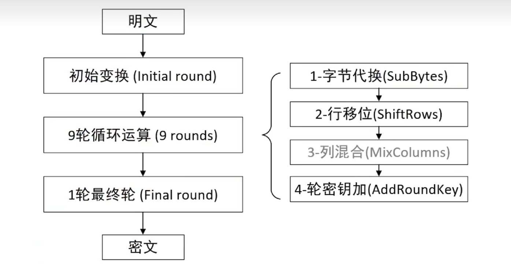

# AES加密算法

#### 一、 AES是什么？

**AES **是一种**对称加密算法**，也是目前全球范围内应用最广泛、最受信任的加密标准之一。

- **对称加密**: 这意味着**加密和解密使用同一个密钥**。

    - **核心比喻**: AES就像一个极其复杂的**保险箱**。用一把特制的钥匙（**密钥**）把**明文**锁进保险箱，它就变成了谁也看不懂的乱码（**密文**）。任何人想要打开保险箱读到原文，都必须拥有**同一把钥匙**。

- **块密码**: AES不是一个字节一个字节地处理数据，而是以**固定大小的数据块**为单位进行操作。

    - 对于AES，这个数据块大小永远是 **128位 \(16字节\)**。

- **三种类型**: AES根据**密钥的长度**分为三种版本，密钥越长，理论上越难破解，但加密过程的轮数也越多：

    - **AES\-128**: 密钥长度128位 \(16字节\)，加密 **10** 轮。

    - **AES\-192**: 密钥长度192位 \(24字节\)，加密 **12** 轮。

    - **AES\-256**: 密钥长度256位 \(32字节\)，加密 **14** 轮。

#### 二、 加密流程与四种变换

AES的加密过程就像一个多层嵌套的魔盒。输入的16字节数据块，要经过多轮复杂且精密的数学变换，最终才输出为16字节的密文。



##### 1\. 状态矩阵

这是理解AES内部工作方式的关键。输入的16字节数据块，在算法内部会被排列成一个 **4x4的字节矩阵**，称为状态矩阵。所有的内部操作都是针对这个矩阵进行的。

```Plain Text
// 输入: B0, B1, ..., B15 (16字节)
 // 状态矩阵:
 | B0  B4  B8  B12 |
 | B1  B5  B9  B13 |
 | B2  B6  B10 B14 |
 | B3  B7  B11 B15 |
```

##### 2\. 加密轮

整个加密过程由三部分组成：

1. **初始密钥加轮**: 一次**轮密钥加**操作。

2. **主要加密轮**: 重复执行 **N\-1** 轮，每轮包含以下**四种变换**。

3. **最终轮**: 执行一轮**不包含列混合**的变换。

##### 3\. 四种核心变换

这四步操作共同实现了密码学中最重要的两个特性：**混淆**和**扩散**。

- **第1步: 字节替换（SubBytes） \- “密码本”**

    - **作用**: 对状态矩阵中的**每一个字节**，都通过一个固定的、被称为**S\-Box**的查找表，替换成另一个字节。

    - **目的**: **混淆**。这是AES中唯一的**非线性**变换，它彻底打乱了输入字节和输出字节之间的简单关系，让攻击者无法通过简单的数学关系来破解。就像一个复杂的密码本，把'A'变成'Q'，'B'变成'X'。

- **第2步: 行移位（ShiftRows） \- “洗牌”**

    - **作用**: 对状态矩阵的**后三行**进行循环左移操作。

        - 第0行: 不移动。

        - 第1行: 循环左移1个字节。

        - 第2行: 循环左移2个字节。

        - 第3行: 循环左移3个字节。

    - **目的**: **扩散**。这个步骤将矩阵中同一列的字节“打散”到不同的列中，确保了单个字节的改动会影响到多个列，实现了信息在行方向上的快速扩散。

- **第3步: 列混合（MixColumns） \- “搅拌机”**

    - **作用**: 对状态矩阵的**每一列**，都进行一次复杂的数学变换（基于伽罗瓦域GF\(2⁸\)的矩阵乘法）。可以理解为将一列中的4个字节**彻底混合**，生成4个全新的字节。

    - **目的**: **扩散**。这是AES中最重要的扩散层。它确保了单个字节的改动，能在下一轮中影响到**整整一列**的4个字节。与**行移位**配合，使得任何一个明文比特的改变，都能像雪崩一样迅速地影响到整个128位的状态块。

    - **注意**: **最终轮没有这一步**。

- **第4步: 轮密钥加（AddRoundKey） \- “注入密钥”**

    - **作用**: 将当前的状态矩阵与一个从主密钥扩展而来的**轮密钥**进行按位**异或\(XOR\)**操作。

    - **目的**: 将**密钥**的信息“混入”到加密过程中。没有这一步，加密过程就是固定的、公开的变换，任何人都可以逆向操作。**轮密钥加**是唯一引入了**密钥**的步骤。

#### 三、 工作模式

AES本身只知道如何加密一个16字节的数据块。但现实中的文件远大于16字节，我们该如何用AES加密一个大文件呢？这就是**工作模式**要解决的问题。

- **ECB \(Electronic Codebook\) \- 电子密码本模式（危险！应避免使用！）**

    - **工作方式**: 将整个文件切分成多个16字节的块，然后**独立地、分别地**对每个块进行AES加密。

    - **致命缺陷**: 如果明文中有重复的块，那么加密后的密文中也会出现**完全相同的重复块**。这会暴露原始数据的**模式**。最著名的例子就是加密一张图片，虽然内容被加密了，但图片的轮廓依然清晰可见。

- **CBC \(Cipher Block Chaining\) \- 密码块链接模式（常用且安全）**

    - **工作方式**: 在加密每个数据块之前，会先将该块与**前一个加密好的密文块**进行**异或\(XOR\)**操作。

    - **引入IV \(初始化向量\)**: 对于第一个数据块，由于没有“前一个密文块”，所以需要一个**随机的、16字节**的**初始化向量 \(IV\)** 来代替。

    - **优点**: 这种“链接”机制彻底解决了ECB的问题。即使明文块相同，由于参与异或的前一个密文块不同，最终加密出来的密文也完全不同。

    - **关键安全要求**: **每次加密都必须使用一个唯一的、不可预测的IV**。IV本身无需保密，通常和密文一起发送。

- **其他现代模式**:

    - **CTR \(Counter Mode\)**: 允许并行加密，效率更高。

    - GCM \(Galois/Counter Mode\): 不仅提供加密（保密性），还能提供消息认证（完整性），是目前TLS 1\.3等现代安全协议中的首选。
    
## AES-128/CTR模式代码示例

```c
#include <stdint.h>

#define AES_KEY_SIZE 16
#define AES_BLOCK_SIZE 16

typedef struct {
    uint8_t round_key[176];
    int rounds;
} AESContext;

void aes_ctr_encrypt(AESContext* ctx, uint8_t* nonce,
                     uint8_t* plaintext, uint8_t* ciphertext, size_t len) {
    uint8_t counter[16];
    uint8_t keystream[16];
    
    memcpy(counter, nonce, 8);
    
    for (size_t i = 0; i < len; i += 16) {
        uint64_t ctr = *(uint64_t*)(counter + 8);
        ctr++;
        *(uint64_t*)(counter + 8) = ctr;
        
        aes_encrypt_block(ctx, counter, keystream);
        
        size_t block_len = (i + 16 < len) ? 16 : (len - i);
        for (size_t j = 0; j < block_len; j++) {
            ciphertext[i + j] = plaintext[i + j] ^ keystream[j];
        }
    }
}
```

#### 四、 总结

1. AES是一种**安全、高效**的**对称块加密**标准，是现代数据加密的基石。

2. 其核心在于通过**多轮**的**四种变换（SubBytes, ShiftRows, MixColumns, AddRoundKey）**，对16字节的数据块进行复杂的**混淆**和**扩散**。

3. 在实际应用中，**选择一个安全的工作模式（如CBC, GCM）**并**正确使用初始化向量（IV）**，与选择AES算法本身同等重要。**绝对不要在生产环境中使用ECB模式！**


