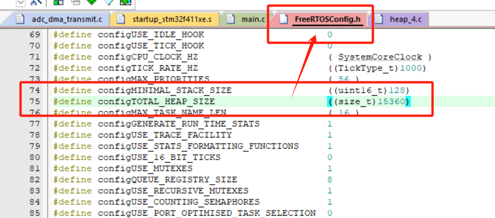
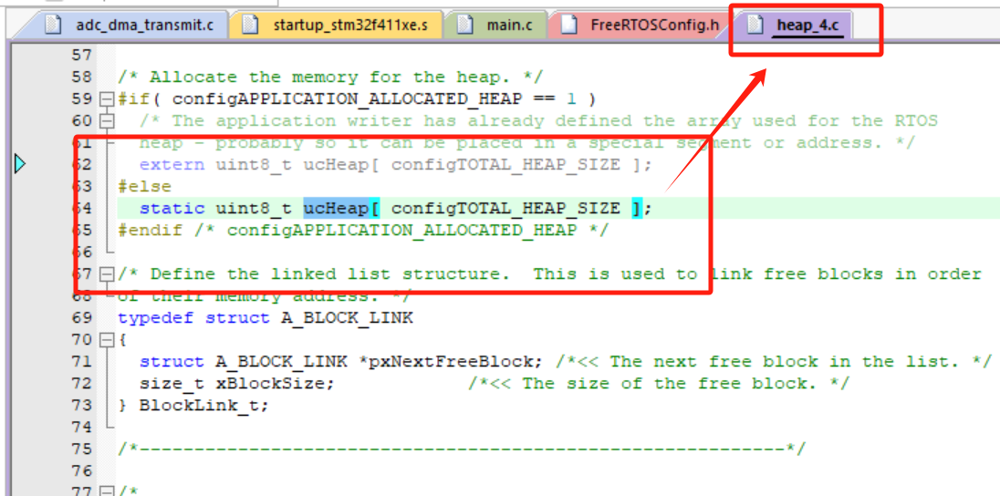
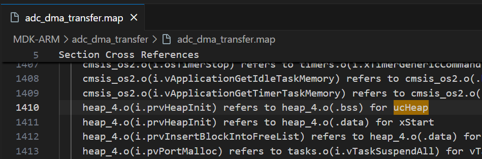
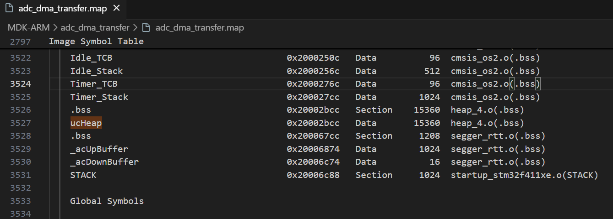
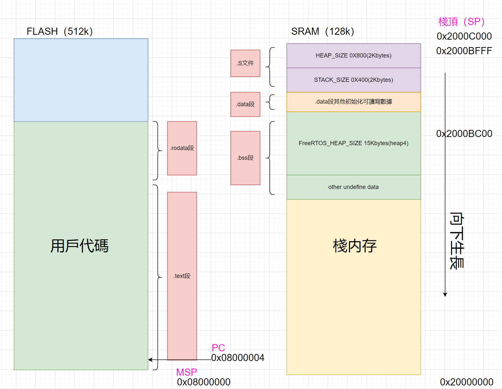

# FreeRTOS打印栈水位V2

## 阅读官方API文档编写实验代码


### FreeRTOSConfig\.h


```C
/* 必需重新定義這3個宏 */
#define configUSE_TRACE_FACILITY                1
#define configUSE_STATS_FORMATTING_FUNCTIONS    1
#define INCLUDE_uxTaskGetStackHighWaterMark     1
```


### 移植代码


```C
/* 1. 打印任務句柄 */
static TaskHandle_t printTaskHandle;

/* 2. 打印任務 */
static void showTaskInformation(void *args)
{
    BaseType_t val;

    char pcWriteBuffer[200] = {0};

    for (int i = 0; i < 10; i++)
    {
        vTaskList(pcWriteBuffer);
        LOG("[loop:%d, tick:xx.]-----------------------------------------\r\n", i);
        LOG("Name    State   Priority    Stack   Num\r\n");
        LOG("%s\r\n", pcWriteBuffer);

        /* 查询系统历史剩余最小内存 */
        LOG("Total FreeRTOS memory size: %d bytes.\r\n", configTOTAL_HEAP_SIZE);                               // 打印FreeRTOS总内存大小（单位字节）
        LOG("The current remaining heap memory size is: %d bytes.\r\n", xPortGetFreeHeapSize());               // 查询当前剩余堆内存大小
        LOG("Historical minimum remaining memory size: %d bytes.\r\n\r\n", xPortGetMinimumEverFreeHeapSize()); // 查询历史剩余最小内存大小

        /* 查询任务历史剩余最小内存  */
        val = uxTaskGetStackHighWaterMark(taskHandleA);
        LOG("Minimum historical remaining memory for the task: %d bytes\r\n ", (int)val * 4);

        vTaskDelay(1000);
    }

    vTaskDelete(NULL);
}


void TaskInit(void)
{
    /* 3.創建打印任務 */
    ret = xTaskCreate(showTaskInformation,
                                        "printTask",
                                        256,
                                        NULL,
                                        2,
                                        &printTaskHandle);
    
    if (ret != pdPASS)
    {
            LOG("xTaskCreate printTask failed! \r\n");
            return;
    }
    return;
}

```


### 实验结果


### 接口说明


```C
/**
 * @detail 当前实时栈深度
 * @param [in] 用於保存所有任務堆棧信息的數組指針
 * @retval none
 */
void vTaskList( char * pcWriteBuffer )

/**
 * @detail 查询当前剩余堆内存大小
 * @param [in] none
 * @retval 剩餘可用任務堆
 */
size_t xPortGetFreeHeapSize( void )

/**
 * @detail 查询历史剩余最小内存大小
 * @param [in] none
 * @retval 歷史最高水位
 */
size_t xPortGetMinimumEverFreeHeapSize( void )

/**
 * @detail 查询任务历史剩余最小内存
 * @param [in] xTask 任務句柄
 * @retval 任务深度，返回值是字
 */
UBaseType_t uxTaskGetStackHighWaterMark( TaskHandle_t xTask )
```


注：`vTaskList()` 返回的数据内容是以字节为单位


查看xPortGetFreeHeapSize\(\) 和 xPortGetMinimumEverFreeHeapSize\(\) 源码：

```C
/*-----------------------------------------------------------*/

size_t xPortGetFreeHeapSize( void )
{
    return xFreeBytesRemaining;
}
/*-----------------------------------------------------------*/

size_t xPortGetMinimumEverFreeHeapSize( void )
{
    return xMinimumEverFreeBytesRemaining;
}
/*-----------------------------------------------------------*/

/* Keeps track of the number of calls to allocate and free memory as well as the
number of free bytes remaining, but says nothing about fragmentation. */
static size_t xFreeBytesRemaining = 0U;
static size_t xMinimumEverFreeBytesRemaining = 0U;

```


我们可以发现，当前剩余堆内存大小和历史剩余最小内存大小，是一个静态变量，那这两个静态变量在哪修改的？


剩余堆栈空间\(xFreeBytesRemaining\) :


历史水位深度\(xMinimumEverFreeBytesRemaining \) : 


xPortGetFreeHeapSize\(\)和 xPortGetMinimumEverFreeHeapSize\(\) 使用总结：

- xFreeBytesRemaining 的值就是在每次调用 pvPortMalloc\(\) 分配空间时，减去这块空间的大小；在调用 vPortFree\(\) 释放空间时，从链表中查找出需要删除的块，将该堆栈空间加上。


- xMinimumEverFreeBytesRemaining 小于 xFreeBytesRemaining 时，更新 xMinimumEverFreeBytesRemaining。


### 计算任务堆栈开销

如何确定一个任务到底需要给它分配多少任务堆栈空间？


1. 当前任务局部变量全部占用多少？

2. 任务中最差情况下，函数嵌套用的深度？

3. 函数传入的参数的数量与大小？


**情景示例：**我们创建打印任务的大小是1024字节（256个字），调用 vTaskList\(\) 接口时，创建了一个200字节长度的数组保存数据。那么请问，"printTask"任务，用多少任务空间？


```C
ret = xTaskCreate(showTaskInformation,
                                        "printTask",
                                        256,
                                        NULL,
                                        2,
                                        &printTaskHandle);


/*--------------------------------------------------------------------------------*/

char pcWriteBuffer[200]
for (int i = 0; i < 10; i++)

vTaskList(pcWriteBuffer);
LOG("[loop:%d, tick:xx.]----------------------------------------\r\n", i);
LOG("Name    State   Priority    Stack   Num\r\n");
```


RTT的日志打印也可以看到任务堆栈开销：


### 其他及资料引用


注意：FreeRTOS单个任务最少需要分配128字（\#define configMINIMAL\_STACK\_SIZE  \(uint16\_t\)128），其中64字节用于创建任务控制块（TCB），剩下64字节用于任务堆栈的开销。


参考链接 《FreeRTOS ROM/RAM FAQ》:

https://www\.freertos\.org/Why\-FreeRTOS/FAQs/Memory\-usage\-boot\-times\-context


### 实验源码


该工程基于STM32F411CEU6，是学员用于验证 \.s 文件，芯片启动时 Heap\_Size 和 Stack\_Size 堆栈空间分配，与 FreeRTOS 的配置文件的空间有何关联？使用 Microlib 库的 malloc\(\) 和 pvPortMalloc\(\) 有什么区别？如果 pvPortMalloc\(\) 使用后，不调 vPortFree\(\) 会怎么样？


[malloc\_no\_free\.zip](图片和附件/malloc_no_free.zip)


### 深入理解MCU的堆栈


startup\_stm32f411xe\.s

```Assembly language
Stack_Size                EQU     0x400

                AREA    STACK, NOINIT, READWRITE, ALIGN=3
Stack_Mem       SPACE   Stack_Size
__initial_sp


; <h> Heap Configuration
;   <o>  Heap Size (in Bytes) <0x0-0xFFFFFFFF:8>
; </h>

Heap_Size      EQU     0x800 ; 开辟2048字节的RAM空间

                AREA    HEAP, NOINIT, READWRITE, ALIGN=3
__heap_base
Heap_Mem        SPACE   Heap_Size
__heap_limit
```


FreeRTOSConfig\.h

```C
#ifndef CMSIS_device_header
#define CMSIS_device_header "stm32f4xx.h"
#endif /* CMSIS_device_header */

#define configENABLE_FPU                         0
#define configENABLE_MPU                         0

#define configUSE_PREEMPTION                     1
#define configSUPPORT_STATIC_ALLOCATION          1
#define configSUPPORT_DYNAMIC_ALLOCATION         1
#define configUSE_IDLE_HOOK                      0
#define configUSE_TICK_HOOK                      0
#define configCPU_CLOCK_HZ                       ( SystemCoreClock )
#define configTICK_RATE_HZ                       ((TickType_t)1000)
#define configMAX_PRIORITIES                     ( 56 )
#define configMINIMAL_STACK_SIZE                 ((uint16_t)128)
#define configTOTAL_HEAP_SIZE                    ((size_t)15360)
#define configMAX_TASK_NAME_LEN                  ( 16 )
#define configGENERATE_RUN_TIME_STATS            1
#define configUSE_TRACE_FACILITY                 1
#define configUSE_STATS_FORMATTING_FUNCTIONS     1
#define configUSE_16_BIT_TICKS                   0
#define configUSE_MUTEXES                        1
#define configQUEUE_REGISTRY_SIZE                8
#define configUSE_RECURSIVE_MUTEXES              1
#define configUSE_COUNTING_SEMAPHORES            1
#define configUSE_PORT_OPTIMISED_TASK_SELECTION  0
```


FreeRTOS在单片机中，是采用静态数组预先分配好任务堆栈的空间






从\.map文件可以看到这个ucHeap数组保存在SRAM的\.bss段






MCU 堆栈资源分配图解：




[ARM\-CMx 堆棧資源理解\.drawio](图片和附件/ARM-CMx%20堆棧資源理解.drawio)


