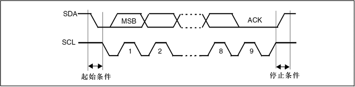

# I2C协议

#### 一、通信速率 \(Communication Rate\)

I2C总线支持多种速率模式，以适应不同应用场景的需求。主设备会根据从设备的能力选择合适的速率进行通信。

|**模式 \(Mode\)**|**最高速率 \(Max Rate\)**|**常用场景**|
|---|---|---|
|**标准模式 \(Standard\-mode\)**|100 kbit/s|兼容性要求高的场合，低速传感器|
|**快速模式 \(Fast\-mode\)**|400 kbit/s|目前最主流的应用模式，适用于绝大多数MCU和外设|
|**快速模式\+ \(Fast\-mode Plus\)**|1 Mbit/s|需要更高数据吞吐量的场合，如OLED显示屏|
|**高速模式 \(High\-speed mode\)**|3\.4 Mbit/s|高速数据采集，需要特定硬件支持|

#### 二、通信帧与时序细节 \(Communication Frame \& Timing\)

I2C协议的“语言”完全由SCL（时钟线）和SDA（数据线）的电平变化来定义。

1. 核心规则与特殊信号

- **数据有效性**: SCL为**高电平**期间，SDA电平**必须稳定**，代表一位有效数据。SDA的电平变化只能在SCL为**低电平**期间进行。

- **起始信号 \(START\)**: 违背规则的特殊信号。在SCL为**高电平**时，SDA出现一个**下降沿**。标志着通信开始，由主设备发起。

- **停止信号 \(STOP\)**: 违背规则的特殊信号。在SCL为**高电平**时，SDA出现一个**上升沿**。标志着通信结束，主设备释放总线。

2. 数据传输帧

I2C以**字节\(8\-bit\)**为单位传输数据，每个字节后都紧跟一个**应答位**，共占用9个SCL时钟周期。

- **数据位**: 8位，**高位\(MSB\)在前**。

- **应答位 \(ACK/NACK\)**: 第9个SCL周期。

    - **ACK \(应答\)**: 接收方将SDA**拉低**，表示成功接收。

    - **NACK \(非应答\)**: SDA**保持高电平**。通常由主设备在读取最后一个字节后发出，以告知从设备停止发送。

3. 时序参数 \(Timing\)

诸如`t_SU;DAT`（数据建立时间）、`t_HD;DAT`（数据保持时间）等纳秒级的时序参数，是I2C协议规范的核心，它们确保了在SCL高电平采样期间，数据是稳定有效的，从而保证了不同厂商设备间的可靠通信。

#### 三、核心读写流程 \(Core Read/Write Procedures\)

4. 主设备写 \(Master Write\)

流程清晰直接：主设备指定从设备地址和内部寄存器地址，然后连续写入数据。

**通信时序**: `[S] [Slave Addr + W(0)] [A] [Reg Addr] [A] [Data 1] [A] ... [P]`

- **步骤分解**:

    1. **`S`**: 主设备发送**起始信号**。

    2. **`Slave Addr + W(0)`**: 发送7位从机地址，尾随一位**写标志****`0`**。

    3. **`A`**: 被寻址的从设备回复**ACK**。

    4. **`Reg Addr`**: 主设备发送要操作的从设备**内部寄存器地址**。

    5. **`A`**: 从设备回复**ACK**。

    6. **`Data 1`**: 主设备发送第一个数据字节。

    7. **`A`**: 从设备回复**ACK**。

    8. **\(重复\)** 主设备可连续写入更多数据，从设备的内部地址指针会自动递增。

    9. **`P`**: 主设备发送**停止信号**，通信结束。

5. 主设备读 \(Master Read\) \- “假写真读”模型

此流程分为两个阶段，因为主设备必须先告知从设备它想读取哪个地址的数据。

**通信时序**: `[S] [Slave Addr + W(0)] [A] [Reg Addr] [A] [Sr] [Slave Addr + R(1)] [A] [Read Data] [A/N] ... [P]`

- **阶段一：“假写” \(设置读取地址\)**

    1. **`S`**** \-\> ****`Slave Addr + W(0)`**** \-\> ****`A`**: 主设备以**写模式**启动通信并寻址从设备。

    2. **`Reg Addr`**** \-\> ****`A`**: 主设备发送它**希望读取的寄存器地址**。此操作的本质是设置从设备的内部地址指针，为后续的读取做准备。

- **阶段二：“真读” \(获取数据\)**

    3. **`Sr`**** \(Repeated START\)**: 主设备发送一个**重复起始信号**。此信号可以在不释放总线的情况下开启一个新的传输方向，是实现“假写真读”的关键。

    4. **`Slave Addr + R(1)`**** \-\> ****`A`**: 主设备再次发送从机地址，但尾随一位**读标志****`1`**。

    5. **`Read Data`**: **从设备**开始在SDA上逐位发送指定寄存器的数据，**主设备**则负责产生SCL时钟并接收数据。

    6. **`A/N`**:
    \*如果主设备还想继续读取下一个字节，它会发送**ACK**。

        - 如果这是主设备需要读取的**最后一个字节**，它会发送**NACK**，以通知从设备停止发送。

    7. **`P`**: 主设备发送**停止信号**，通信结束。

