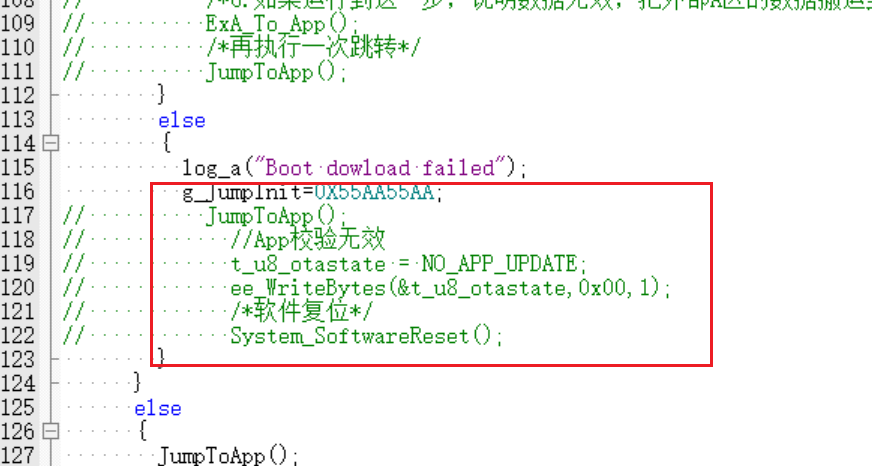

# OTA面试整理

# 一、全流程分析

新的固件来了之后，首先会经过AES加密变成密文，其中密文的最后一个字节的数据一般都是MD5的值。对应的密钥和向量值会在出厂之前写入加密芯片中，后续解密的时候，需要从加密芯片获取密钥和向量。

此后，手机端（PC端）通过蓝牙连接跟NRF52840建立通信，然后基于Ymodem协议将加密好的密文固件逐帧传输到外部Flash的A区，在这个传输过程会通过CRC逐帧校验，并且Ymodem协议支持断帧重传的机制，所以可以尽可能确保最终传输到A区的密文固件是完整的。

在确保传到外部Flash的A区固件是完整的之后，会修改MCU内部Flash中标志位Flag的值，表明此时有新的固件到来，手表端会弹出UI界面询问用户是否需要更新，如果用户点击更新，则会软复位BootLoader。

BootLoader被复位之后，通过查询标志位，发现有新的固件来了，于是开始把A区的密文固件1KB、1KB的往SRAM搬运，此时也会读取外部加密芯片中存储的密钥对加密固件依次解密，将解密后的固件数据逐渐的写入MCU的内部Flash中。

当A区的密文全部被解密完写入MCU内部Flash之后，此时就得到了固件的明文数据和MD5值的明文数据。然后就开始计算解密后固件数据的MD5的值，把这个MD5的值与MD5值的明文数据进行比对，如果二者一致，则说明固件是完整没有被修改的。如果发现两个MD5的值对不上，则校验不通过，此时会将外部Flash的B区备份密文数据回滚到MCU内部Flash，以防产品变砖。（这个B区备份数据是OTA升级之前能正常运行的App固件对应的密文数据）

如果MD5校验通过了，此时会在内部Flash写一个新的标志位，表明“固件初步校验通过，但不确定新的App固件是否能完整执行，需要进一步判断”。

然后就会开启看门狗，并且BootLoader会跳转到新的固件App。跳转之后，如果在一定时间内没有写入新的标志位（这个标志位主要是表明新固件App可以正常运行到程序末端），则视为新写入内部Flash的这个App固件有问题，此时就会触发系统复位回到BootLoader，然后BootLoader会将外部Flash的B区备份密文数据回滚到MCU内部Flash，以防产品变砖。

但如果新的App固件顺利执行到程序末端，，就会再次修改标志位，表明新的App固件确实是完整且能正常执行的，再次触发BootLoader软复位。此时BootLoader中会将外部Flash的A区密文固件拷贝到外部Flash的B区备份区进行备份，备份完之后，擦除所有相关的内部Flag标志位，然后重新跳转到App，完成整次OTA升级与固件备份。

# 二、细节问题Q\&A

## 2\.1 标志位放在加密芯片还是内部Flash，为什么？

一开始我们的方案是把这些标志位都放在加密芯片里，但是后面发现这样有问题，因为如果是这样的话，我们需要配置好IIC才能去加密芯片读数据（加密芯片跟MCU是IIC通信？），在后续BootLoader跳转App之前，还需要把IIC外设的配置给反向初始化，而且如果读出来的数据有问题、有遗漏的话，对于整个OTA升级的过程都是有很严重的影响。所以我们后面还是选择把标志位都直接存放在内部flash里面，读写标志位的速度更快，也缩短了整个OTA升级环节的时间，加速了整个OTA流程，用户体验感更好。

## 2\.2 BootLoader的上电自检是什么意思？

这个自检主要是检查一下内部Flash的标志位，根据标志位去做对应的处理。比如说判断一下是否有新的固件存放到了外部Flash的A区；解密之后搬入到内部Flash的新固件是否通过了MD5校验，是否完整；新的App固件是否能正常执行完并且喂狗等等

## 2\.3 为了保证新固件的完整性，都有哪些方法措施？

最基本的肯定就是AES加密了，我们存在外部Flash里面的数据都是密文数据，然后会把密钥放在加密芯片内部，需要解密的时候再去加密芯片读取密钥。

然后就是CRC校验，这个主要就是Ydoem协议里面每一帧格式自带的校验，我们在把密文固件写入外部A区的时候，是逐帧传输的，每一帧都会有CRC校验，尽可能确保写入到A区的密文固件是完整的。

其次就是MD5哈希值校验，主要用在后续把A区固件往MCU的内部Flash写入的时候，判断最终写入到MCU内部Flash的明文数据是否有误，是否完整，是否被篡改。

相当于CRC校验和MD5哈希值校验用在了整个OTA过程的两个阶段。

除此之外，我们OTA是双Bank的方案，支持版本回滚，如果发现写入MCU内部Flash的固件有问题，就会把外部B区的备份固件写入MCU内部Flash，这也是一个保护措施。

## 2\.4 喂狗与写入Flash标志位的关系

固件数据解密写入到内部Flash之后，会复位到Bootloader，Bootloader这边开启看门狗，假设是4S，然后跳转到新的App执行。

App程序必须在4S内执行完毕，然后在内部flash写入新的标志位，以表明新固件App可以正常运行到程序末。如果4S后没有写入新的标志位，则会强制复位到Bootloader，这时候Bootloader检测发现flash标志位没有被更新，那么就认为此次下载的App有问题，立刻回滚B区备份的固件。

4S的看门狗设置时间就是为了给足App足够的执行时间，如果4S内没有执行完毕，且完成更新标志位的任务，就会直接复位。

## 2\.5 OTA升级的前提条件（什么时候对产品升级）

**产品价值层面：**需要我们新来的固件的确有一些功能或者用户使用体验上的提升，或者修复了某些重大Bug，才会考虑OTA升级

**环境与设备状态层面：**保障网络环境、蓝牙信号的稳定，手表电量要充足、外部Flash的空间裕度足够、然后选择在设备空闲期间实现后台无感升级

**固件加密层面：**新固件在写入外部Flash的A区之前，先做一次完整性预校验。新固件下载到A区之后，在Bootloader解密之前，还需要做一次签名认证，用提前写入在MCU内部OPT Flash区域的公钥进行签名验证。验证通过之后才会读取加密芯片的密钥进行固件解密。

**版本回滚方面：**外部Flash的B区必须得有一个确定可以正常运行的备份App固件，以防产品变砖；新固件的版本号必须高于现运行固件的版本号，否则不允许将新固件写入外部Flash的A区。以防有人通过某些其他渠道获取到了我们老版本的固件，万一让用户的产品逆向版本回退了，这个会非常影响用户体验。

**用户层面：**用户授权升级这个最重要

## 2\.6 如果OTA升级过程中断电了，是否可以100%保证产品完全不变砖？

如果就只是断电这一个故障，没有伴随其他故障一同到来的话，基本上是可以百分百保证产品不变砖的。

我们目前项目的OTA方案暂时不支持断点续传

如果是在把新固件通过Ymodem协议传输到外部FlashA区的过程中断电了，完全没影响。因为如果Bootloader检测不到有效的新固件准备好了的标志，会直接启动原有的正常 App，A区里面目前不完整的固件会被直接丢弃，下次升级的时候，擦除一下Flash然后重新传输即可。

如果是解密之后写入内部Flash的这个过程中断电了，说明此时MCU内部运行的固件不完整，上电之后肯定是无法正常启动了。但是上电重启之后首先会校验内部Flash的App固件完整性（MD5校验），这里肯定会校验失败，失败之后直接从外部B区回滚备份的固件。

然后我们其实也有最终的兜底方案，每次设备上电Bootloader启动时，也会校验一下外部B区备份固件的完整性和签名。如果B区备份固件校验失败，则立即从当前正常运行的App固件重新加密备份到B区，保证任何时候B区都有可用的兜底固件。

再极端一点，直接在BootLoader做最终保护，在所有策略都失效的情况下，通过串口反馈一条加急失效指令，让上层重新传输有效固件进行升级。

## 2\.7 这个加快启动速度这节课就是意思是不是就是每次Bootloader需要逐个复位所以及这个可以然后直接跳转APP就可以了是不

以前的方案上跳转前需要把Boot使用的外设，全部恢复默认。有内部flash之后，就可以在Boot不操作内部寄存器的情况下直接跳转，Boot初始化是因为他有升级的要求。并不是一般来说，之前的方案都比较老化。

这是一个意思，只不过之前需要重新初始化后才会跳转，但是现在就直接复位然后去跳转

