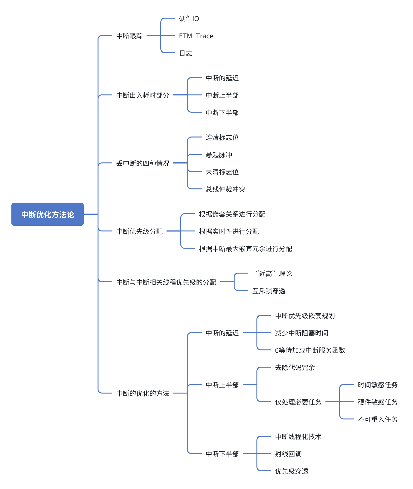

# 深入理解中断优化

### 中断优化方法论：构建一个高效的“急诊室”

#### 核心比喻

- **中断系统**: 医院的**“急诊室”**。

- **外部事件 \(硬件中断\)**: **“救护车抵达”**。

- **CPU**: 急诊室里**唯一的值班医生**。

- **ISR \(中断服务程序\)**: 医生对病人进行的**“初步诊断和紧急处理”**。

- **RTOS任务 \(Task\)**: 在普通病房里的**“常规治疗”**。

**优化的最终目标**：确保急诊室（中断系统）在面对各种突发情况时，能够**响应最快、处理最高效、不出任何差错**，从而保证整个医院（嵌入式系统）的平稳运行。

### 一、 中断跟踪 \(急诊室性能监控\)

#### 比喻概括

- 在优化急诊室流程之前，我们必须先知道瓶颈在哪里。这需要在急诊室的关键位置安装监控系统，来精确测量和记录每个环节的效率。

#### 知识点深挖与实例

1. **硬件IO \(GPIO翻转法\)**: 在ISR的入口处将一个GPIO（通用输入输出端口）引脚拉高，出口处拉低。通过示波器或逻辑分析仪测量此引脚上的脉冲，可以**精确获知中断的执行耗时（脉冲宽度）**和**中断延迟（外部信号到脉冲上升沿的时间）**。

    - **实例**: 在一个ADC转换完成中断中，ISR入口执行`HAL_GPIO_WritePin(GPIOC, GPIO_PIN_13, 1);`，出口执行`...WritePin(..., 0);`。示波器上测得的脉冲宽度就是ADC中断处理的精确微秒数。

2. **ETM Trace \(硬件追踪\)**: 利用ARM内核内置的ETM（嵌入式追踪宏单元）硬件，通过专业的Trace调试器，可以**无侵入地**、**实时地**捕获CPU的完整执行流。

    - **实例**: Segger Ozone等调试软件的Trace视图会显示一条时间线，清晰可见`main_loop`被`TIM2_IRQHandler`中断了5\.2微秒，期间`TIM2_IRQHandler`又被更高优先级的`CAN_RX_IRQHandler`中断了1\.5微秒。

3. **日志 \(软件日志\)**: 在ISR的入口和出口读取一个高精度定时器的值，并将时间戳和中断ID存入一个环形缓冲区，由一个低优先级任务负责打印。

    - **实例**: UART接收中断将收到的字符`'A'`和32位定时器的计数值`12345`打包成一条日志消息，放入环形缓冲区。后台的日志任务稍后会打印出`[T=12345] UART RX: 'A'`。

### 二、 中断出入耗时部分 \(急诊室的固定流程耗时\)

#### 比喻概括

- 这是急诊室流程中的固定开销，即无论病人病情如何，从“救护车门打开”到“医生开始诊断”，以及“诊断完毕”到“病人送往病房”这段无法避免的时间。

#### 知识点深挖与实例

1. **中断的延迟**: 从硬件事件发生到ISR第一条指令执行的时间。它由**硬件仲裁**、**CPU硬件自动压栈**（Cortex\-M4上为12个时钟周期）和**取向量/指令流水线加载**等固定硬件开销构成。

    - **实例**: 在一个100MHz的STM32F4上，仅硬件压栈就需要 `12 * (1/100MHz) = 120纳秒`。这是任何中断响应都无法避免的“物理延迟”。

2. **中断上半部**: 即ISR本身。其耗时包括编译器生成的**函数序言/尾声**（用于保存/恢复R4\-R11寄存器）和**用户编写的核心逻辑**。

    - **实例**: 如果ISR中用到了6个被调用者保存寄存器，编译器可能会生成`PUSH {R4-R7, R8, LR}`，这会增加额外的压栈时间和栈空间消耗。

3. **中断下半部**: 指的是被ISR唤醒后、在RTOS任务上下文中执行的后续处理逻辑。

### 三、 丢中断的四种情况 \(医疗事故分析\)

#### 比喻概括

- 在繁忙的急诊室中，流程上的疏忽或外部干扰可能导致病人被忽略或处理不当，这些都是需要排查的“医疗事故”。

#### 知识点深挖与实例

1. **连清标志位**: 由于时序问题，软件的“清除中断标志”操作**覆盖**了硬件几乎同时发生的“设置中断标志”操作。

    - **实例**: SPI接收ISR通过读取数据寄存器`SPI->DR`来清除`RXNE`标志，但代码末尾又执行了一个`SPI->SR = 0;`的通用清除操作。如果一个新字节恰好在读取`DR`之后、`SR=0`之前到达，它设置的`RXNE`标志就会被后者错误地清除，导致该字节数据丢失。

2. **悬起脉冲**: 由硬件信号干扰（毛刺）导致的“虚假”中断，或因未清标志位等错误导致的**中断风暴**（无限循环进入同一中断）。

    - **实例**: 一个没有硬件RC滤波的机械按键，一次按下可能在引脚上产生多次快速的电平抖动，导致GPIO中断被触发5\-10次，而实际上只有一次有效按键。

3. **未清标志位**: ISR在执行完毕后，**忘记清除**中断源的标志位，导致中断被重复触发。

    - **实例**: 在定时器更新中断中，完成了所有工作，但忘记了调用`__HAL_TIM_CLEAR_IT(&htim, TIM_IT_UPDATE);`。只要中断返回，NVIC就会看到标志位仍有效，立即再次进入该ISR，导致系统完全卡死在此中断中。

4. **总线仲裁冲突**: 当CPU需要通过总线去Flash读取ISR指令时，总线恰好被另一个总线主控器（例如DMA）占用。

    - **实例**: 一个高优先级的CAN报文到达，触发中断。但此时DMA正在进行一次SD卡到内存的大数据块传输，占用了AHB总线。CPU对Flash的取指请求被暂停了几个微秒，这个延迟可能导致CAN硬件接收FIFO溢出，丢失了紧随其后的下一帧报文。

### 四、 中断优先级分配 \(病人分级制度\)

#### 比喻概括

- 急诊室必须建立一套科学的病人分级制度，确保病情最紧急的病人能最先得到救治。

#### 知识点深挖与实例

1. **根据嵌套关系进行分配**: 如果中断A的处理依赖于中断B的结果，则中断B的优先级应高于A。

2. **根据实时性进行分配**: **处理截止时间（Deadline）最短**的中断应被赋予最高的**抢占优先级**。

    - **实例**: 在一个电机控制器中，优先级分配如下（数值越小，优先级越高）：

        - **抢占优先级0**: ADC中断（用于FOC电流采样，deadline \< 20μs）。

        - **抢占优先级1**: CAN总线中断（处理报文，deadline \< 1ms）。

        - **抢占优先级2**: UART中断（处理调试命令，无严格deadline）。

3. **根据最大嵌套余量进行分配**: 在硬实时系统中，通过精确计算，确保在最坏情况下，最高优先级中断的响应时间依然满足其要求。

### 五、 中断与中断相关线程优先级的分配

#### 比喻概括

- 急诊室与普通病房之间必须有高效、无冲突的协作流程，确保病人交接顺畅。

#### 知识点深挖与实例

1. **“近高”理论**: 用于处理中断下半部的RTOS任务，其优先级应该设置得**足够高**。

    - **实例**: 一个`CAN_rx_task`（优先级10）被CAN ISR唤醒。但一个`log_to_flash_task`（优先级11）也准备就绪。调度器会先运行log任务，可能耗时20ms。这导致CAN报文的处理延迟了20ms，违反了协议要求。**正确做法**：将`CAN_rx_task`的优先级设为12。

2. **互斥锁穿透**: **ISR绝对不能等待一个可能被任务持有的互斥锁**，这会直接导致**优先级反转**甚至死锁。

    - **实例**: `low_prio_task`锁住了一个共享缓冲区。此时一个高优先级的网络中断发生，其ISR试图直接写入该缓冲区，造成了数据竞争。**正确做法**：ISR应将收到的网络数据包放入一个消息队列，由`low_prio_task`作为唯一消费者来安全地处理。

### 六、 中断的优化的方法

#### A\. 优化中断的延迟 \(缩短出诊时间\)

1. **中断优先级嵌套规划**: （见第四部分）。

2. **减少中断阻塞时间**: 最小化“关中断”（`__disable_irq()`）代码段的长度和使用频率。

    - **实例**: 错误做法：`__disable_irq(); process_data(); calc_crc(); __enable_irq();`。正确做法：`__disable_irq(); g_counter++; __enable_irq();`。

3. **0等待加载中断服务函数**: 将对延迟要求最苛刻的ISR代码从慢速的Flash**重定向到高速SRAM或TCM（紧耦合内存）**中执行。

    - **实例**: 在链接脚本中定义一个`.ramfunc`段，并使用`__attribute__((section(".ramfunc")))`将电机FOC中断服务函数放入其中。

#### B\. 优化中断上半部 \(精简急救流程\)

1. **去除代码冗余**: ISR代码中应避免函数调用、复杂的逻辑分支、循环、浮点运算和`printf`等耗时操作。

    - **实例**: 在ISR中，将`float temp = (adc_val * 3.3) / 4095.0;` 替换为 `g_latest_adc_val = adc_val;`，将浮点运算移到任务中。

2. **仅处理必要任务**: 在ISR中，只处理那些如果推迟到任务中执行就会导致数据丢失或硬件错误的**绝对必要**的操作。

    - **时间敏感任务**: **实例**：`adc_value = ADC1->DR;`，必须在下一次ADC转换覆盖它之前读取。

    - **硬件敏感任务**: **实例**：`DMA1_Channel1->CCR &= ~DMA_CCR_EN;`，必须立即关闭DMA通道以重新配置。

    - **不可重入任务**: **实例**：`g_new_packet_flag = 1;`，原子地更新一个标志位。

#### C\. 优化中断下半部 \(提升病房治疗效率\)

1. **中断线程化技术**: ISR通过RTOS的IPC机制（最优选择是**消息队列**）来唤醒下半部任务，并安全地传递数据。

    - **实例**: UART ISR收到一个字节后，调用`xQueueSendToBackFromISR()`将其放入一个字符队列。一个`protocol_parse_task`则通过`xQueueReceive()`来等待并处理这些字符。

2. **射线回调**: 一种适用于无RTOS系统的延迟处理技术。ISR仅设置一个标志，由主循环轮询并执行回调。

3. **优先级穿透**: （见第五部分）确保下半部任务的优先级足够高，并使用支持**优先级继承**的互斥锁来防止优先级反转。

