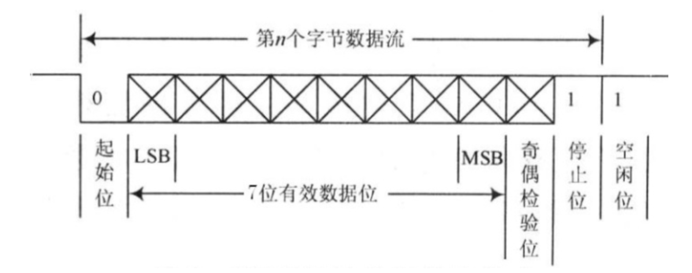

# 串口协议\(UART, RS\-232, RS\-485\)

#### 一、UART/USART：异步通信的逻辑协议基础

1. 核心定义

- **UART \(Universal Asynchronous Receiver/Transmitter\)** 是一种**异步通信协议**，也是实现该协议的硬件模块。

- **核心特性**:

    - **异步 \(Asynchronous\)**: 无需时钟线，通过数据帧内的起始/停止位进行同步。

    - **全双工 \(Full\-Duplex\)**: 使用独立的`TX`\(发送\)和`RX`\(接收\)线，可同时收发。

    - **逻辑电平 \(Logic\-Level\)**: 直接使用TTL/CMOS电平（如0V/3\.3V）传输，抗干扰性弱，仅适用于**板级或短距离**通信。

- **USART vs\. UART**: USART是UART的超集，增加了同步模式。但在绝大多数应用中，USART都工作在异步模式，因此两者常可互换提及。

2. 数据帧结构

这是UART实现异步同步的关键。
`[Start Bit] [Data Bits (5-9)] [Parity Bit (Optional)] [Stop Bit(s) (1/1.5/2)]`

- **空闲状态**: `TX`线保持高电平。

- **起始位 \(Start Bit\)**: `TX`线由高拉低，并保持1个位时间。这个下降沿是接收方开始计时的“同步信号”。

- **数据位 \(Data Bits\)**: 5\-9位有效数据，通常为8位，**最低位\(LSB\)在前**。

- **校验位 \(Parity Bit\)**: 可选的奇偶校验，用于简单的错误检测。

- **停止位 \(Stop Bit\(s\)\)**: `TX`线拉高，并保持1个位时间，标志一帧结束。

3. 波特率 \(Baud Rate\)

由于没有时钟线，收发双方必须**事先约定**好相同的传输速率（如9600, 115200 bps），否则解码会完全错误。

#### 二、RS\-232与RS\-485：将逻辑信号转换为物理传输

RS\-232和RS\-485**不是通信协议**，而是**物理层标准**。它们定义了如何将UART的逻辑信号转换为能在更长距离、更复杂环境中可靠传输的**物理电信号**。

##### **RS\-232：经典的“点对点”物理层**

- **核心特性**:

    - **信号类型**: **单端非平衡高电压**。所有信号都相对于一根公共地线\(GND\)。

        - 逻辑 `1`: **负电压** \(\-3V to \-15V\)

        - 逻辑 `0`: **正电压** \(\+3V to \+15V\)

    - **通信模式**: **点对点 \(Point\-to\-Point\)**，设计用于连接两个设备。

- **优点**: 实现简单，是PC串口\(COM Port\)的传统标准。

- **缺点**:

    - **抗干扰性一般**: 易受共模噪声和地电位差影响。

    - **传输距离短**: 通常限于15米以内。

- **与UART的关系**: 需要**收发器芯片\(如MAX232\)**进行电平转换。

##### **RS\-485：工业级的“多点”物理层**

- **核心特性**:

    - **信号类型**: **差分信号**。使用两根线\(A, B\)的**电压差**来表示逻辑。

        - 逻辑 `1`: V\_A \- V\_B \> \+200mV

        - 逻辑 `0`: V\_A \- V\_B \< \-200mV

    - **通信模式**: **多点/多用户 \(Multi\-Drop\)**，允许多个设备挂在同一总线上。最常见的**两线制**为**半双工**。

- **优点**:

    - **抗干扰性极强**: 差分信号能有效抵御共模噪声。

    - **传输距离远**: 可达1200米。

    - **组网能力强**: 适合构建设备网络。

- **与UART的关系**: 需要**收发器芯片\(如MAX485\)**进行电平转换，且半双工模式下通常需要一个额外的**方向控制引脚\(DE/RE\)**。

#### 三、核心特性对比

|**特性**|**UART \(逻辑层\)**|**RS\-232 \(物理层\)**|**RS\-485 \(物理层\)**|
|---|---|---|---|
|**定义层面**|逻辑协议|物理层接口标准|物理层接口标准|
|**信号类型**|TTL/CMOS \(0V/3\.3V\)|单端高电压 \(\-15V/\+15V\)|差分信号 \(A/B线电压差\)|
|**通信模式**|全双工|点对点，全双工|多点，半双工 \(两线制\)|
|**抗干扰性**|弱|一般|**极强**|
|**传输距离**|\< 1米 \(板级\)|\< 15米|**\< 1200米**|
|**典型应用**|MCU与外设间|PC COM口，老式设备|工业自动化，楼宇控制|

#### 四、总结：语言与扩音器的关系

理解这三者关系的最佳方式，就是“语言”与“扩音器”的类比：

- **UART**: 是通信的**“语言”**。它定义了信息的结构（数据帧）和语速（波特率）。这种“语言”只能用于近距离的“耳语”（板级通信）。

- **RS\-232 \& RS\-485**: 是两种不同的**“扩音器系统”**。它们不关心语言内容，只负责将“耳语”转换成能传得更远的物理声音信号。

    - **RS\-232**: 像一个**有线的对讲机**。声音大，但只能两人通话，距离近且易受干扰。

    - **RS\-485**: 像一个**专业的公共广播系统**。可以在广阔、嘈杂的工业现场，让多个设备清晰地进行广播和接收。

