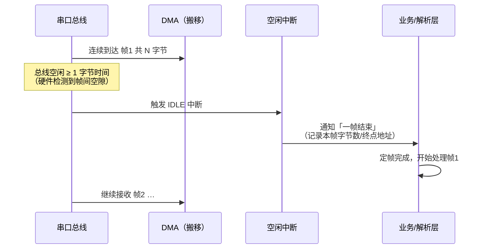
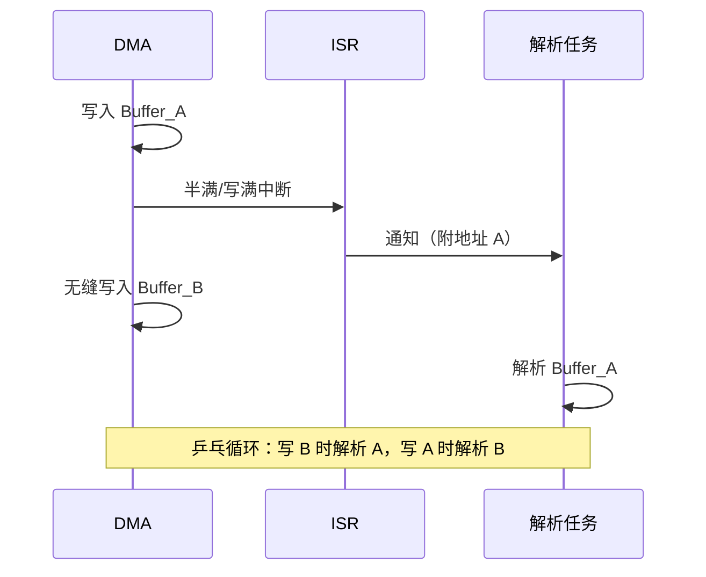
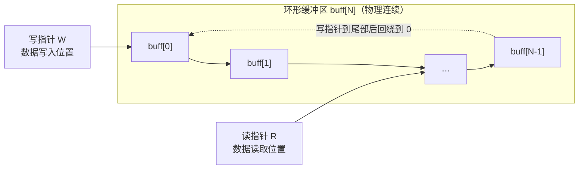
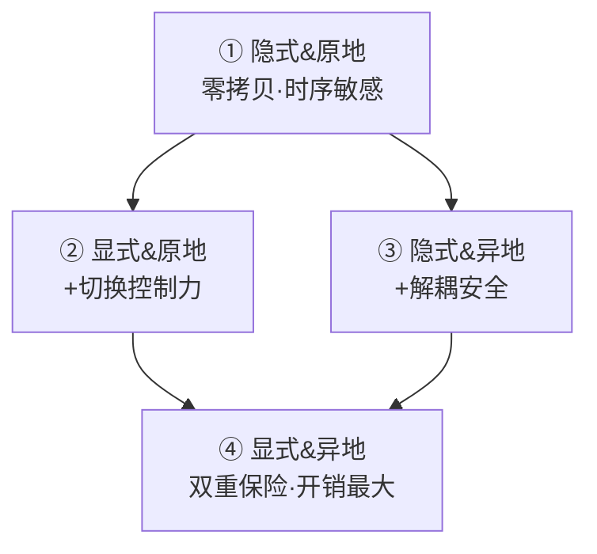
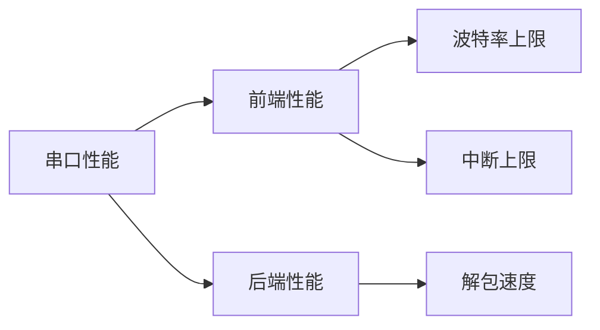

# 串口接收不定长数据并结合 DMA 实现环形缓冲区

## 1. 应用背景：为什么串口接收「难」

串口（UART）是最经典的异步串行通信接口，但它的数据有两个让接收方头疼的特性：

- **随机到达**：外部设备在**不确定的时间**产生数据，CPU 无法预知「下一个字节何时来」。
- **长度不定**：很多协议（AT 指令、自定义帧、GPS 报文等）数据长度**不固定**，接收方不知道「这一帧有多长」。

于是产生核心矛盾：在**不知道何时来、不知道来多少**的前提下，必须做到**不丢数据、低延迟**。一旦某字节丢失，轻则单帧解析失败，重则后续所有帧因错位而连锁失效。

> 类比：像你不知道什么时候有人往信箱投信、也不知道每封信多长。你要么随时盯着信箱（中断），要么雇个专门搬信的人（DMA），而信箱本身得能装下多封信而不被挤掉（缓冲）。

解决这个问题，拆成四个环节，也是本文的主线：


**定帧**解决「不定长」问题，**搬移 + 缓冲**解决「高效、不丢」问题，**解包**解决「数据怎么用」问题。四者环环相扣。

## 2. 定帧：如何判定一帧数据接收完毕

不定长数据的最大难点是**分帧**——接收方必须知道「这一帧到哪儿结束」。常用定帧手段：

| 方式 | 原理 | 优点 | 缺点 | 适用 |
| --- | --- | --- | --- | --- |
| **空闲中断（IDLE）** | 总线空闲超过一个字节时间，硬件产生 IDLE 中断 | 硬件判断、不占额外字节、不依赖协议 | 要求帧间间隔足够大；帧内不能有长停顿 | 无帧头/帧尾的不定长协议 |
| **接收超时（软件定时）** | 每收一字节重置定时器，超时未收 → 判一帧结束 | 可移植，无硬件依赖 | 定时器开销；阈值需按波特率调 | 无 IDLE 中断的 MCU |
| **帧头/帧尾 + 长度字段** | 协议固定帧头帧尾，按长度字段收够字节 | 可靠、抗任何间隔 | 占用带宽；解析是状态机 | 有协议约定的系统 |
| **校验（奇偶/CRC）** | 判定帧内容是否完整、有效 | 防错位、防坏帧 | 只是「验尸」，不能代替定帧 | 任何协议的补充 |

以最常用的**空闲中断**为例，时序如下：



**小结**：定帧方式决定了「一帧的边界在哪」，是整个体系的前提。定帧没做好，后面缓冲和 DMA 再快，解析的也是错位的数据。

## 3. 搬移与缓冲：数据如何从硬件进入内存

### 3.1 搬移方式

#### 单字节中断（RX 中断）

每来一个字节触发一次中断，CPU 进 ISR 读走 1 字节放入缓冲。

- 优点：实现最简单，任何 MCU 都支持。
- 缺点：**每字节一次中断**，波特率越高 CPU 被淹没得越狠。

以 115200bps（8N1，10bit/字节）为例：数据速率 ≈ **11520 字节/秒**，即每字节约 **87µs**。若单次 ISR 耗时 20µs，CPU 占用率 ≈ 20µs × 11520/s ≈ **23%**；若到 1Mbps，则是每秒 10 万次中断，CPU 几乎被全部吃光。

#### DMA（Direct Memory Access）

DMA 是总线上的 **Master**，能把串口接收寄存器的数据**自动搬运**到内存，全程无需 CPU 参与，搬完触发一次中断。

- 优点：解放 CPU，吞吐高，ISR 频率从「每字节一次」降到「每半缓冲/每帧一次」。
- 缺点：DMA 目标必须是**连续地址空间**；需要配置 DMA 通道；定帧不能依赖逐字节中断。

> 类比：单字节中断 = 每次来一封信你亲自去取；DMA = 雇了个信使，一次把一堆信搬回家，搬完只叫你一次。

### 3.2 缓冲结构（由浅入深）

缓冲设计始终围绕两个目标：

- **接收不阻塞**：数据随时能进来，不会因 CPU 忙而丢。
- **解析不覆盖**：正在解析的数据不会被新到的数据冲掉。

#### 单缓冲

只有一块 buffer。数据写入后，CPU 若来不及解析就被新数据覆盖 → **上溢（overrun）**。

结构最简单，但基本无法应对「不定长 + 高速」，只适合数据量极小、处理极快的场景。

#### 双 Buffer（AB Buffer）

用两块缓冲交替：解析 A 时 DMA 写 B，解析 B 时 DMA 写 A，解决「解析期间被覆盖」问题。有两种实现：

- **隐式双 Buffer**：一块连续地址空间，用 DMA 的**半满中断（Half Transfer）**天然切分。循环模式下 DMA 写满前半段触发半满中断，你解析前半段，DMA 无缝继续写后半段。硬件自动「乒乓」，软件不切地址。
- **显式双 Buffer**：两块独立内存 A/B，ISR 里**显式切换** DMA 目标地址。控制更灵活，但 ISR 要做切换、要维护两缓冲状态。

> 类比：双 Buffer 像两个水桶轮流接水——一个桶在接（DMA 写入），另一个桶在倒（CPU 解析）。



#### 环形缓冲区（Ring Buffer / Circular Buffer）

一块连续内存，用**读/写指针**在数组范围内**回绕（wrap）**，首尾相接成环。本质是用数组模拟一个队列：



**关键要素：**

- **写指针**：每写入一字节后移，尾部回绕到 0。
- **读指针**：每读走一字节后移，同样回绕。
- **空/满判断**（两种方案）：
  1. **计数法（推荐）**：维护 `count`，写 +1、读 -1。`count == 0` 为空，`count == size` 为满。简单可靠，不丢一个字节。
  2. **指针法**：写指针追上读指针 → 满；读指针追上写指针 → 空。但需留一个空位（或用标志位）区分空满，易出错。

**DMA 与环形缓冲区的结合：**

- **硬件环形（Circular DMA）**：DMA 的地址寄存器本身支持环形回绕，写入地址自动回到起点，天然匹配环形缓冲区——DMA 搬移 + 环形逻辑，CPU 零参与搬运。
- **软件环形**：DMA 写入固定数组，DMA 中断（半满/全满）时由 CPU 把数据拷进逻辑环形队列，或直接在 DMA 数组上做环形。灵活，但多一次拷贝或指针管理。

相比双 Buffer：双 Buffer 每个周期最多容纳一帧（乒乓）；环形缓冲区能**连续缓存多帧**，解包端可以「攒一批处理一批」，容忍后端偶尔的慢。

> 类比：双 Buffer 是「两个水桶倒着用」，环形缓冲区是「一个环形传送带，随时上货、随时取货」。

## 4. 串口驱动分层：前端与后端

把串口驱动按职责切成两层，各管一段：

- **前端（Front-end）**：把数据**从硬件搬进缓冲**。包含：搬移方式（中断/DMA）+ 缓冲策略。
- **后端（Back-end）**：把缓冲里的数据**解析成业务帧**。包含：解包策略。

解包的两种方式：

- **原地解包（In-place）**：直接在 DMA/缓冲所在的内存区间解析，**零拷贝**，但必须保证 DMA 不覆盖这段（时序敏感）。
- **异地解包（Out-of-place）**：先用 DMA/CPU 把数据**拷贝**到独立解析缓冲再解析。多一次拷贝，但解耦彻底。

于是「缓冲 × 解包」构成 **2×2 架构矩阵**：

| 缓冲 \ 解包 | 原地解包（零拷贝） | 异地解包（一次拷贝） |
| --- | --- | --- |
| **隐式双 Buffer**（硬件乒乓） | ① 隐式 & 原地 | ③ 隐式 & 异地 |
| **显式双 Buffer**（ISR 切地址） | ② 显式 & 原地 | ④ 显式 & 异地 |

四种架构由简到繁，下面逐一展开。

### ① 隐式双 Buffer & 原地解包

**流程：**
1. DMA 循环模式写入连续 Buffer 前半段 → 触发**半满中断**。
2. ISR：清标志 → 通知前端线程（附当前终点地址）→ 退出。
3. DMA 无缝继续写后半段。
4. 后端：直接在原 Buffer 前半段区间内解包。

**特点：**
- **零拷贝**：数据从 DMA 到解包始终在同一块内存。
- **隐式切换**：利用 DMA 循环模式天然「乒乓」，ISR 只通知、不管理切换。
- **时序敏感**：解包必须在 DMA 覆盖该段之前完成（半满→全满窗口内），否则需关中断或信号量保护。

**适用场景**：数据包结构简单、解析速度快、对延迟和内存极为敏感的嵌入式系统。

### ② 显式双 Buffer & 原地解包

**流程：**
1. DMA 写满 Buffer_A → 触发中断。
2. ISR：清标志 → 通知前端（附 Buffer_A 地址）→ **显式切换 DMA 目标为 Buffer_B** → 退出。
3. DMA 开始写 Buffer_B；后端在 Buffer_A 原地解包。

**特点：**
- **真并行**：显式切换保证 DMA 绝不覆盖正在解析的 Buffer_A，消除覆盖风险。
- **零拷贝**：同样无需搬运。
- **管理复杂**：需维护两缓冲状态（哪个满、哪个在写），ISR 要执行切换操作。

**适用场景**：数据量较大、解包耗时较长、必须严格保证 DMA 不覆盖待解析数据的场景。

### ③ 隐式双 Buffer & 异地解包

**流程：**
1. DMA 循环写前半段 → 半满中断。
2. ISR 通知前端（附当前终点地址）。
3. 前端：把前半段数据**拷贝**到独立的 data_buffer_1 → 通知后端（附地址）。
4. 后端：在 data_buffer_1 上解包。

**特点：**
- **一次拷贝**：引入一次从 DMA Buffer 到独立缓冲的拷贝开销。
- **解耦彻底**：解包线程与 DMA Buffer 完全解耦，解包慢也不会阻塞 DMA 或影响下一帧接收。
- **保留隐式优势**：ISR 仍无需管理 Buffer 切换。

**适用场景**：解包逻辑复杂耗时、数据帧需要多次消费、或需要原始数据留档的场合。

### ④ 显式双 Buffer & 异地解包

**流程：**
1. DMA 写满 Buffer_A → 中断触发。
2. ISR：清标志 → 通知前端（附 Buffer_A 地址）→ 显式切换 DMA 至 Buffer_B → 退出。
3. 前端：拷贝 Buffer_A → data_buffer_1 → 通知后端。
4. 后端：在 data_buffer_1 上解包。

**特点：**
- **双重保险**：显式双 Buffer 保证 DMA 写入与数据拷贝的并行安全；异地解包保证解包与前端处理的并行安全。
- **开销最大**：一次显式切换 + 一次拷贝，且需 Buffer_A、Buffer_B、data_buffer_1 **三块内存**。
- **最灵活**：ISR、前端、后端完全解耦，各自以最大效率运行，互不阻塞。

**适用场景**：高吞吐率、协议复杂、系统资源相对充裕、对实时性和稳定性要求极高的工业通信或网关设备。

**四者的演进关系：**



- ①→②：把「隐式」换「显式」，换来切分自定义的控制力；
- ①→③：把「原地」换「异地」，换来解耦与防覆盖安全；
- ②/③→④：都朝「更解耦、更安全、更重」的方向演进。

## 5. 中断处理与实时性

串口数据到来是**无法阻挡**的：如果数据到达时系统还没准备好（中断被高优先级打断、ISR 执行太久），就会产生**上溢错误**，丢数据，造成系统不稳定。

因此，串口驱动稳定性由两个时间决定：

- **中断延迟（Interrupt Latency）**：从中断请求发出到 ISR 真正开始执行的等待时间。受系统关中断、高优先级中断占用影响。
- **中断处理时间（ISR Execution Time）**：ISR 内部执行耗时。越久越容易错过下一次数据到达。

**ISR 职责最小化**是核心原则：

- ISR 只做三件事：**清中断标志**、**更新状态/指针**、**触发通知**（信号量 / 任务唤醒）。
- 不做：数据搬运（交给 DMA）、数据解析（交给后端线程）。
- ISR 保持极短，串口丢数据的概率才趋近于零。

**上溢规避手段：**
1. 用 DMA + 足够大的缓冲——DMA 搬走数据，CPU 慢一点也不会丢。
2. 合理设置中断优先级——串口/DMA 中断优先级应高于一般外设。
3. ISR 内禁止耗时操作——不打印、不解析、不调用长函数。
4. 用空闲中断定帧，替代逐字节轮询。

## 6. 性能计算

串口性能拆成**前端性能**与**后端性能**两块：



### 前端性能

- **波特率上限**：决定数据到达速率。115200 → 11520 B/s → 每字节 86.8µs。更高波特率（如 921600）时，每字节仅约 10.8µs。
- **中断上限**：单字节中断模式下，中断频率 ≈ 波特率 ÷ 10（bit/字节）。中断频率越高，CPU 被吞噬越多。

**CPU 占用率估算公式：**

```
CPU 占用率 ≈ 单次 ISR 耗时 × 每秒中断次数
```

单字节中断：20µs × 11520/s ≈ 23%（115200bps）；换成 DMA 后，中断频率降到「每半缓冲一次」或「每帧一次」，CPU 占用几乎可忽略。

### 后端性能

- **解包速度**：取决于协议复杂度、校验方式（CRC 比奇偶贵）、解析算法。
- 若解包慢于接收，就需要缓冲积累（环形缓冲区/多帧缓冲）来吸收峰值，否则丢帧。

### 瓶颈判定

- 前端是**吞吐**问题（能不能收进来），后端是**延迟**问题（能不能及时消化）。
- 判断方法：
  - 缓冲经常满/溢出 → 前端吞吐不足，或缓冲容量太小；
  - 解包排队越来越长 → 后端太慢，需异地解包 / 多线程 / 优化解析。
- **环形缓冲区容量估算**：容量 ≥ 单帧最大长度 × 期望缓冲的帧数；经验上可按「波特率对应字节率 × 可容忍的最大延迟」下界推算。

## 7. 架构演进与对比

从最简到最完善，串口接收方案按 6 级演进：

| # | 方案 | 定帧 | 搬移 | 缓冲 | CPU 占用 | 内存 | 复杂度 | 适用场景 |
| --- | --- | --- | --- | --- | --- | --- | --- | --- |
| 1 | 串口单字节中断 | 逐字节中断 | 中断 | 单缓冲 | 高 | 低 | 最低 | 低速、简单调试 |
| 2 | 单字节中断 + DMA | DMA 完成中断 | DMA | 单缓冲 | 中 | 低 | 低 | 定长数据、中低速 |
| 3 | 单字节中断 + DMA + 环形缓冲区 | DMA + 环形 | DMA | 环形 | 中 | 中 | 中 | 不定长、中低速 |
| 4 | 空闲中断 + DMA + AB 缓冲 | 空闲中断 | DMA | 双 Buffer | 低 | 中 | 中 | 不定长、解析快 |
| 5 | 空闲中断 + DMA + DMA 硬件双 Buffer | 空闲中断 | DMA | 隐式双 Buffer | 低 | 中 | 中 | 不定长、吞吐高 |
| 6 | 空闲中断 + DMA + 环形缓冲区 | 空闲中断 | DMA | 环形 | 低 | 高 | 高 | 不定长、高吞吐、多帧积累 |

**演进逻辑：**

- 1 → 2：引入 DMA，把 CPU 从逐字节中断中解放。
- 2 → 3：引入环形缓冲区，能容纳不定长、多帧数据。
- 3 → 4：定帧从「完成中断」升级为「空闲中断」，不再依赖长度已知。
- 4 → 5：AB 缓冲升级为硬件隐式双 Buffer，去掉 ISR 显式切换。
- 5 → 6：隐式双 Buffer 升级为环形缓冲区，支持多帧连续接收与完全解耦。

注意 **6 与 4/5 的本质区别**：4/5 是「乒乓」——每个周期只处理一帧；6 的环形缓冲区能**连续缓存多帧**，解包端可以攒批处理，后端偶尔慢也不丢。

## 8. 总结：如何选择

从需求反向选型：

| 需求 | 推荐方案 | 原因 |
| --- | --- | --- |
| 低速调试、收发简单命令 | **1** 单字节中断 | 最简单，够用 |
| 定长数据、中等速率 | **2** DMA + 单缓冲 | DMA 解放 CPU |
| 不定长、中低速率、内存紧张 | **3** DMA + 环形缓冲区 | 环形缓存多帧 |
| 不定长、解析快、内存敏感 | **4** 空闲中断 + DMA + AB 缓冲 | 零拷贝 + 低开销 |
| 不定长、吞吐高、追求简洁 | **5** 空闲中断 + DMA + 硬件双 Buffer | 隐式乒乓，省管理 |
| 不定长、高吞吐、解析慢、需多帧积累 | **6** 空闲中断 + DMA + 环形缓冲区 | 最完善，解耦彻底 |

**三个决策问题：**

1. **数据定长还是不定长？** 不定长 → 必须先做定帧（空闲中断 / 超时 / 帧头帧尾）。
2. **速率高不高？** 高 → 必须 DMA，并让中断频率降到「每帧/每半缓冲一次」。
3. **解析快不快、要不要留档或多帧消费？** 需要 → 环形缓冲区 + 异地解包。

一句话总结：**越接近「不定长 + 高吞吐 + 解析慢」，越需要向「环形缓冲区 + 异地解包」的方案靠拢**——这正是本文标题所指的架构。
