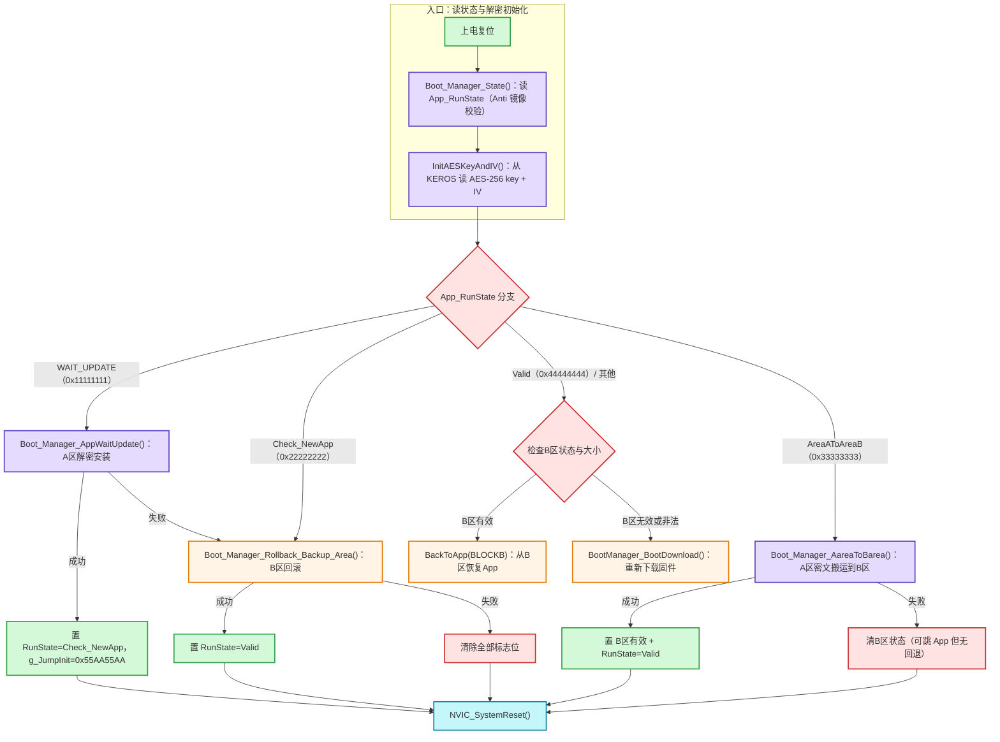

## 定义

BootManager 状态机是 [[Bootloader]] 侧的 OTA 安装调度核心：[[Bootloader]] 上电后读取内部 Flash 中的 **App_RunState 标志**（含 **Anti 反码镜像**校验），按状态值分派到不同的安装/回滚/跳转处理函数，并用"设标志 + 软复位"驱动状态迁移。以下为一个智能手表 OTA **参考工程**中的具体状态机（状态值定义于 `Boot_Manager.h`）：

| 状态 | 值 | 含义 |
| --- | --- | --- |
| `APP_WAIT_UPDATE` | `0x11111111` | 有新固件在外部 A 区，需解密安装 |
| `APP_Check_NewApp` | `0x22222222` | 上轮升级成功待确认；进入即表示需回退版本 |
| `APP_AreaAToAreaB` | `0x33333333` | 新 App 已验证，把 A 区搬运到 B 区备份 |
| `APP_Valid` | `0x44444444` | 当前 App 有效，直接跳转运行 |
| `APP_AreaBState_Valid` | `0x55555555` | B 区备份有效（辅助标志） |

## 关键信息

### 状态迁移图

> 唯一权威图。节点 ID 已语义化，按「入口 / 状态分派 / 回滚兜底」三阶段分组；状态值与处理函数映射见下方表格。此图被 [[综合-智能手表OTA全流程]] 内嵌引用。

### 处理函数映射

| 状态 | 处理函数 | 成功迁移 | 失败处理 |
| --- | --- | --- | --- |
| `WAIT_UPDATE` | `Boot_Manager_AppWaitUpdate()` = `BackToApp(BLOCKA)` + `CheckAppValid()` | → `Check_NewApp` + 软复位 | 回滚 B 区 |
| `Check_NewApp` | `Boot_Manager_Rollback_Backup_Area()` = `BackToApp(BLOCKB)` | → `Valid` + 软复位 | 清全部标志 + 软复位 |
| `AreaAToAreaB` | `Boot_Manager_AareaToBarea()`（A 区密文拷贝到 B 区） | → B 区有效 + `Valid` + 软复位 | 清 B 区状态（可跳 App 但无回退） |
| 其他/无效 | 检查 B 区状态/大小 | B 区有效 → `BackToApp(BLOCKB)` 恢复；否则 `BootManager_BootDownload()` | — |

### 关键机制

- **Anti 反码镜像**：每个标志位存 `value` 与 `~value` 两份，读取时 `value == ~Anti` 才视为有效，防 Flash 位翻转/损坏误判。
- **上电跳转变量 `g_JumpInit`**：SRAM `0x2001FFF0`，软复位不清零。`BootManager_JumpToApp()` 在 main 最开头执行——命中则启动 [[看门狗]] 后跳 App，不命中再走状态机。**深层作用：短路 `Check_NewApp` 的回退语义**——安装成功后置 `0x55AA55AA`，使下一次复位在状态机之前直接跳新 App，把"能否运行"的确认交给新 App + 看门狗；详见 [[综合-智能手表OTA全流程]] 控制权交接节。**源码确证**：命中后先清为 `0xFFFFFFFF` 再启 IWDG 再跳转（防 IWDG 复位后二次命中死循环）；`RunState==Valid` 分支不启 IWDG。
- **下载兜底**：`BootManager_BootDownload()`（按键触发）：`Ymodem_Receive` → `BackToApp(BLOCKA)` → `CheckAppValid` → 置 AreaASize/BSize/BState=Valid、RunState=`Check_NewApp`、`g_JumpInit=0x55AA55AA` → 软复位。

## 关联连接
- [[Bootloader]] — 状态机的宿主
- [[OTA升级]] — 概念总览
- [[综合-智能手表OTA全流程]] — 完整流程可视化
- [[Keros]] / [[AES]] — 解密依赖
- [[W25Q64]] — A/B 区物理载体
- [[看门狗]] — 跳转后验证
- [[摘要-ota面试整理]] — 来源
