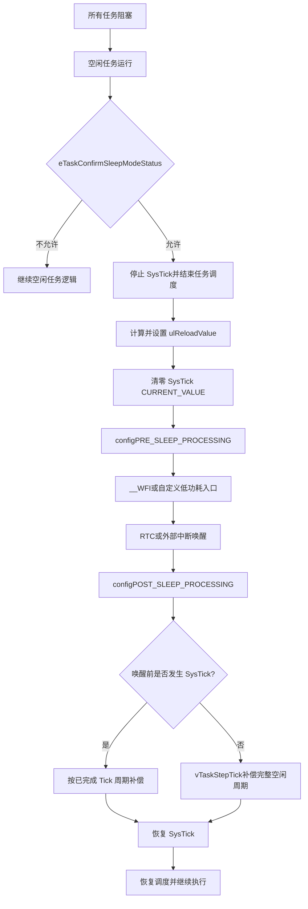

## 定义

Tickless Idle（无节拍空闲）是 [[FreeRTOS]] 的低功耗机制：当系统预计有一段时间没有任务需要运行时，暂时停止周期性的 SysTick 中断，让 MCU 进入低功耗状态；被 RTC 或外部中断唤醒后，再根据实际睡眠时长补偿系统 Tick。

它优化的是**空闲期间的节拍开销**，不是取消 FreeRTOS 的时间基准。唤醒后必须恢复正确的 Tick，否则延时、超时和任务调度都会产生时间偏差。

## 为什么需要 Tickless

普通 RTOS 空闲时仍可能每 1 ms 触发一次 SysTick。即使没有任务运行，CPU 也会周期性醒来处理中断，带来额外的功耗和唤醒开销。Tickless 的核心做法是：

> **没有任务要运行时，把许多个短周期 Tick 合并成一次较长的睡眠；醒来后一次性补齐这些 Tick。**

收益包括：

- 减少 SysTick 中断次数和 CPU 唤醒次数；
- 延长 MCU 在 Sleep、Stop 或 RTC 低功耗状态中的连续停留时间；
- 将低功耗模式的选择权交给应用，而不局限于单一 Sleep 模式；
- 空闲任务不再通过忙等待消耗 CPU。

## 触发条件

Tickless 并不是“所有任务阻塞后必然睡眠”，通常需要同时满足：

1. 所有应用任务都处于阻塞或挂起状态；
2. 空闲任务获得运行机会；
3. 内核计算出的预计空闲时间达到实现允许的范围；
4. `eTaskConfirmSleepModeStatus()` 确认没有更高优先级任务即将就绪，也不存在需要取消睡眠的条件；
5. 临界区、调度器状态和端口实现允许进入低功耗。

如果确认结果不允许睡眠，系统继续运行空闲任务或处理其他就绪工作，不执行 Tickless 睡眠流程。

## 完整触发与唤醒流程

### 睡眠前

默认实现 `vPortSuppressTicksAndSleep(xExpectedIdleTime)` 会围绕以下动作组织流程：

1. 再次确认是否允许睡眠；
2. 禁止 SysTick，防止其在睡眠期间周期性唤醒 CPU；
3. 根据 `xExpectedIdleTime` 计算 `ulReloadValue`，写入 `portNVIC_SYSTICK_LOAD_REG`；
4. 清零 `portNVIC_SYSTICK_CURRENT_VALUE_REG`；
5. 调用 `configPRE_SLEEP_PROCESSING(xExpectedIdleTime)`；
6. 执行 `__WFI()`，或由钩子切入 Stop/RTC 等更深低功耗模式。

### 唤醒后

唤醒原因可能是 RTC、外部 GPIO 中断、通信外设中断或其他中断。恢复流程通常是：

1. 执行 `configPOST_SLEEP_PROCESSING(xExpectedIdleTime)`，恢复必要的时钟和外设；
2. 判断睡眠期间是否由 SysTick 提前唤醒；
3. 计算实际完成的 Tick 周期；
4. 调用 `vTaskStepTick(ulCompleteTickPeriods)` 补偿内核 Tick；
5. 恢复 SysTick 使能；
6. 退出 Tickless 函数，继续执行后续逻辑，并由调度器选择应运行的任务。

## 关键函数与职责

| 阶段 | 函数或寄存器 | 职责 |
|---|---|---|
| 睡眠许可 | `eTaskConfirmSleepModeStatus()` | 判断进入睡眠是否安全 |
| 停止节拍 | `portNVIC_SYSTICK_CTRL_REG` | 清除 `ENABLE` 位，停止 SysTick |
| 配置睡眠时长 | `portNVIC_SYSTICK_LOAD_REG` | 写入预计睡眠时间对应的重载值 |
| 清除旧计数 | `portNVIC_SYSTICK_CURRENT_VALUE_REG = 0` | 让新睡眠周期从确定状态开始 |
| 睡眠前扩展 | `configPRE_SLEEP_PROCESSING()` | 关闭外设、拉 GPIO、切换电源策略等 |
| 睡眠入口 | `__WFI()` / `HAL_PWR_EnterSTOPMode()` | 执行等待中断或进入更深低功耗 |
| 睡眠后扩展 | `configPOST_SLEEP_PROCESSING()` | 恢复时钟、外设和板级状态 |
| Tick 补偿 | `vTaskStepTick()` | 修正内核时间，使延时和超时保持正确 |
| 恢复节拍 | `portNVIC_SYSTICK_CTRL_REG` | 重新使能 SysTick |

## 三种实现方式

| 方式 | 执行位置 | 进入模式 | 特点 |
|---|---|---|---|
| 非 Tickless | Idle Task 中直接执行 `__WFI()` | Sleep | 每个 Tick 仍可能唤醒 CPU，改动最少但节能有限 |
| 默认实现 | `port.c` 中的 `vPortSuppressTicksAndSleep()` | Sleep（默认） | 内核负责 SysTick 重载与 Tick 补偿，通用性较好 |
| 自定义实现 | 应用层 `vApplicationSleep()` 或端口定制入口 | Sleep / Stop / RTC | 可按平台选择更深睡眠和外部低频时钟，但需自行保证时间补偿正确 |

## 工程注意事项

- **Tick 补偿不可省略**：只停止 SysTick 而不调用 Tick 补偿，会导致系统时间停滞，任务延时和超时判断失真。
- **唤醒源要匹配睡眠模式**：进入 Stop 或 RTC 方案前，应明确 RTC、GPIO、通信外设等唤醒源是否在该模式下仍可工作。
- **Stop 唤醒后重配时钟**：若底层进入 [[低功耗模式]] 的 Stop 模式，唤醒后通常需要重新配置系统时钟；该动作应放在睡眠后处理钩子或自定义睡眠函数中。
- **注意提前唤醒**：外部中断可能早于预计时间到来，因此应按实际经过的 Tick 周期补偿，而不是盲目使用预计空闲时间。
- **不要把“空闲”误认为“可睡眠”**：临界区、即将超时的任务、挂起调度器或端口限制，都可能使本次睡眠被取消。
- **深睡眠要验证唤醒代价**：更深模式虽然功耗更低，但可能关闭时钟、丢失外设状态，恢复成本高于普通 Sleep。

## 与普通空闲和低功耗模式的关系

- [[FreeRTOS]] 决定“预计多久没有任务需要运行”以及何时调用 Tickless 端口函数；
- [[WFI与WFE]] 提供 Cortex-M 的等待入口；
- [[低功耗模式]] 决定 MCU 实际停止哪些时钟或电源域；
- RTC 或外部中断负责唤醒；
- Tickless 代码负责把硬件睡眠时间重新映射回 RTOS 的 Tick 时间线。

因此，Tickless 是 **RTOS 空闲调度 + Cortex-M 等待指令 + MCU 电源管理 + Tick 时间补偿** 的组合机制，而不是单独的一条低功耗指令。

## 关联连接

- [[摘要-freertos-tickless]] — 本概念的素材摘要
- [[FreeRTOS]] — RTOS 调度与 Tick 基础
- [[任务调度]] — 空闲任务和阻塞任务的调度关系
- [[低功耗模式]] — Sleep、Stop、Standby 的硬件行为
- [[WFI与WFE]] — Cortex-M 等待指令
- [[综合-降低cpu占用率]] — 降低 CPU 活动与功耗的五级阶梯
- [[综合-启动到任务切换]] — FreeRTOS 接管 CPU 的上下文
