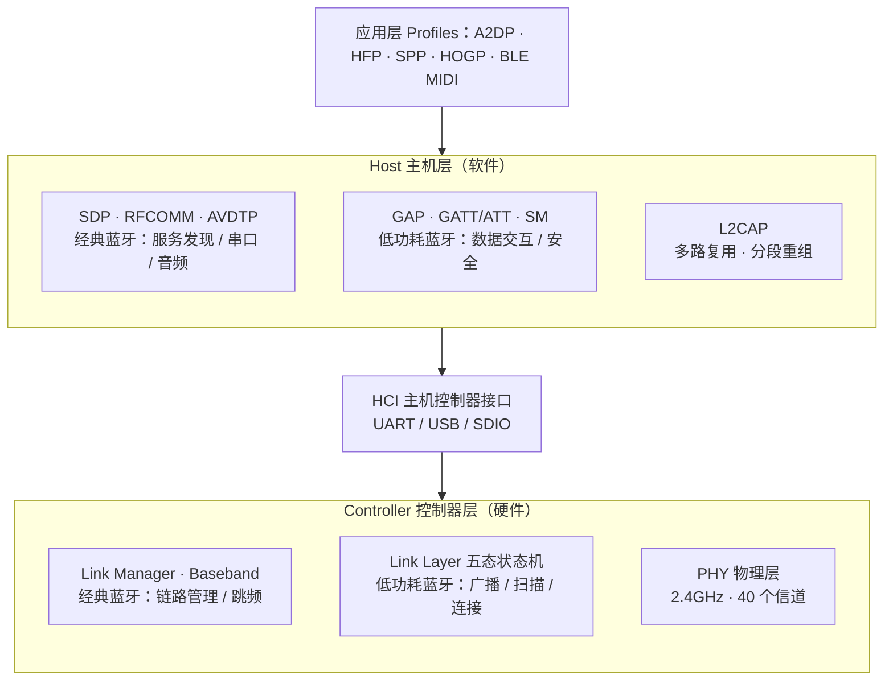

## 定义

蓝牙协议栈是蓝牙技术联盟（SIG）定义的**分层通信协议体系**，分为 **Host（主机，软件实现）** 与 **Controller（控制器，硬件实现）** 两大部分，中间由 **HCI（Host Controller Interface）** 分隔。自蓝牙 4.0 起为**双模架构**：经典蓝牙（BR/EDR）与低功耗蓝牙（LE）共享 2.4GHz 射频前端，但各自运行独立协议栈——LE 以 GATT/服务特性为数据核心，BR/EDR 以 SDP/RFCOMM/AVDTP 支撑音频与串口应用。

## 架构图

## 分层职责

### Host 层（软件）

- **L2CAP**（Logical Link Control and Adaptation Protocol）：逻辑链路控制与适配协议，将多个高层协议的数据**多路复用**到一条链路，并负责**分段重组**（大包拆分传输）。经典蓝牙与 LE 共用。
- **GAP**（Generic Access Profile）：定义设备角色（Central/Peripheral）、广播、扫描、连接建立与安全模式，对应 [[低功耗蓝牙]] 的发现与连接语义。
- **GATT / ATT**：**LE 数据交互的核心**。ATT 定义"属性"的读写模型，GATT 在其上组织服务/特性/UUID，详见 [[GATT服务]]。
- **SM**（Security Manager，LE 特有）：配对、密钥生成/分发与链路加密。
- **BR/EDR 特有**：
  - **SDP**（Service Discovery Protocol）：服务发现，是经典蓝牙的"服务目录"；
  - **RFCOMM**：串口仿真协议，承载 SPP 等串口类应用；
  - **AVDTP/AVCTP**：音频/视频分发与控制协议，承载 A2DP（音频流）、AVRCP（遥控）。

### HCI（Host Controller Interface）

主机与控制器之间的**标准接口**，传输 HCI 命令、事件与数据包，物理载体常为 UART、USB、SDIO。

### Controller 层（硬件）

- **BR/EDR**：**Link Manager**（链路管理、鉴权与密钥分发）+ **Baseband**（基带：79 个 1MHz 信道、1600 跳/秒、数据包构造与差错控制）。
- **LE**：**Link Layer**（链路层）实现五态状态机——就绪/广播/扫描/发起/连接，负责 PDU 构造与信道选择，详见 [[BLE状态机]]；**PHY**（物理层）提供 40 个 2MHz 信道（3 广播 + 37 数据），详见 [[BLE广播]]。

## 双模对比

| 层 | BR/EDR 经典蓝牙 | LE 低功耗蓝牙 |
|---|---|---|
| 应用 Profile | A2DP / HFP / SPP / HID | HOGP / BLE MIDI / 传感器 |
| 服务发现 | SDP | GATT（服务/特性） |
| 数据通道 | RFCOMM、AVDTP | ATT/GATT |
| 安全 | Link Manager 鉴权 + 加密 | Security Manager 配对密钥 |
| 链路管理 | Link Manager + Baseband | Link Layer 状态机 |
| 物理层 | 79×1MHz 信道、跳频 | 40×2MHz 信道、3 广播 + 37 数据 |

## 关联连接
- [[低功耗蓝牙]] — LE 技术实体，本栈的 LE 半边
- [[GATT服务]] — LE 数据交互层（ATT/GATT）
- [[BLE广播]] — LE 物理层/链路层的广播机制
- [[BLE状态机]] — LE 链路层五态
- [[HID协议]] / [[蓝牙MIDI协议]] — 应用 Profile 层实例
- [[ESP32]] / [[NRF52840]] — 实现该协议栈的典型 SoC
- [[摘要-低功耗蓝牙-广播数据分析]] / [[摘要-低功耗蓝牙-状态切换]] / [[摘要-低功耗蓝牙-服务与特性]] / [[摘要-低功耗蓝牙-midi]] / [[摘要-低功耗蓝牙-hid]] — 来源
