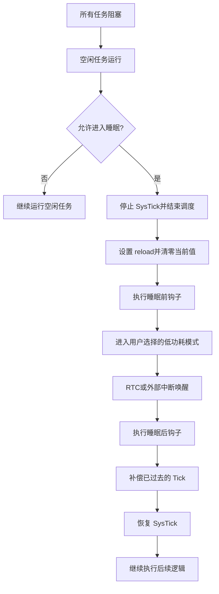

## 核心摘要

- 这组图片素材介绍 FreeRTOS 的 **Tickless Idle（无节拍空闲）**：系统处于空闲状态时，尽量避免 SysTick 周期性中断打扰，让 MCU 长时间睡眠，从而降低功耗。
- 当所有任务都进入阻塞、空闲任务运行且内核判断允许睡眠时，FreeRTOS 会停止 SysTick，结束任务调度，并根据预计空闲时间设置 SysTick 重载值；随后通过 `__WFI()` 或用户自定义的低功耗方案进入 Sleep、Stop 或 RTC 等模式。
- 外部中断或 RTC 到来后，MCU 被唤醒。唤醒流程先执行睡眠后的钩子，再判断实际经过的 Tick 数，通过 `vTaskStepTick()` 补偿系统节拍，恢复 SysTick，最后继续执行睡眠函数返回后的逻辑。
- 素材列出了默认 `vPortSuppressTicksAndSleep()` 的关键函数，以及非 Tickless、默认实现和自定义实现三种 Tickless 方案。核心原则是：**睡眠前暂停节拍，唤醒后补齐节拍，再恢复调度**。

## 关键流程

## 关键函数速查

| 步骤 | 相关函数或寄存器 | 作用 |
|---|---|---|
| 判断是否允许睡眠 | `eTaskConfirmSleepModeStatus()` | 确认系统是否可以进入低功耗状态 |
| 停止 SysTick | `portNVIC_SYSTICK_CTRL_REG &= ~portNVIC_SYSTICK_ENABLE_BIT` | 禁止 SysTick 中断，避免睡眠期间被周期性 Tick 唤醒 |
| 设置重载值 | `portNVIC_SYSTICK_LOAD_REG = ulReloadValue` | 设置预计空闲时间对应的 SysTick 计数值 |
| 清除当前值 | `portNVIC_SYSTICK_CURRENT_VALUE_REG = 0` | 确保 SysTick 从新配置的周期重新计数 |
| 睡眠前钩子 | `configPRE_SLEEP_PROCESSING(xIdleTime)` | 允许用户执行 GPIO 拉低、电源管理等准备动作 |
| 执行睡眠 | `__WFI()` 或 `HAL_PWR_EnterSTOPMode()` | 等待中断或进入用户选择的低功耗模式 |
| 唤醒源 | RTC 或外部中断 ISR | 唤醒 CPU，并触发后续 Tickless 处理 |
| 睡眠后钩子 | `configPOST_SLEEP_PROCESSING(xExpectedIdleTime)` | 执行恢复外设、日志等唤醒后操作 |
| Tick 补偿 | `vTaskStepTick(ulCompleteTickPeriods)` | 将系统 Tick 调整到睡眠结束后的正确位置 |
| 恢复 SysTick | `portNVIC_SYSTICK_CTRL_REG = portNVIC_SYSTICK_ENABLE_BIT` | 恢复系统节拍，继续任务调度 |

## 关联连接

- [[Tickless空闲机制]] — 将素材提炼为可复用的概念页
- [[FreeRTOS]] — Tickless Idle 所属的实时操作系统
- [[低功耗模式]] — MCU 进入 Sleep/Stop/Standby 等低功耗状态的机制
- [[WFI与WFE]] — Cortex-M 等待中断/事件的指令入口
- [[综合-降低cpu占用率]] — 从让权到睡眠的 CPU 降载阶梯
