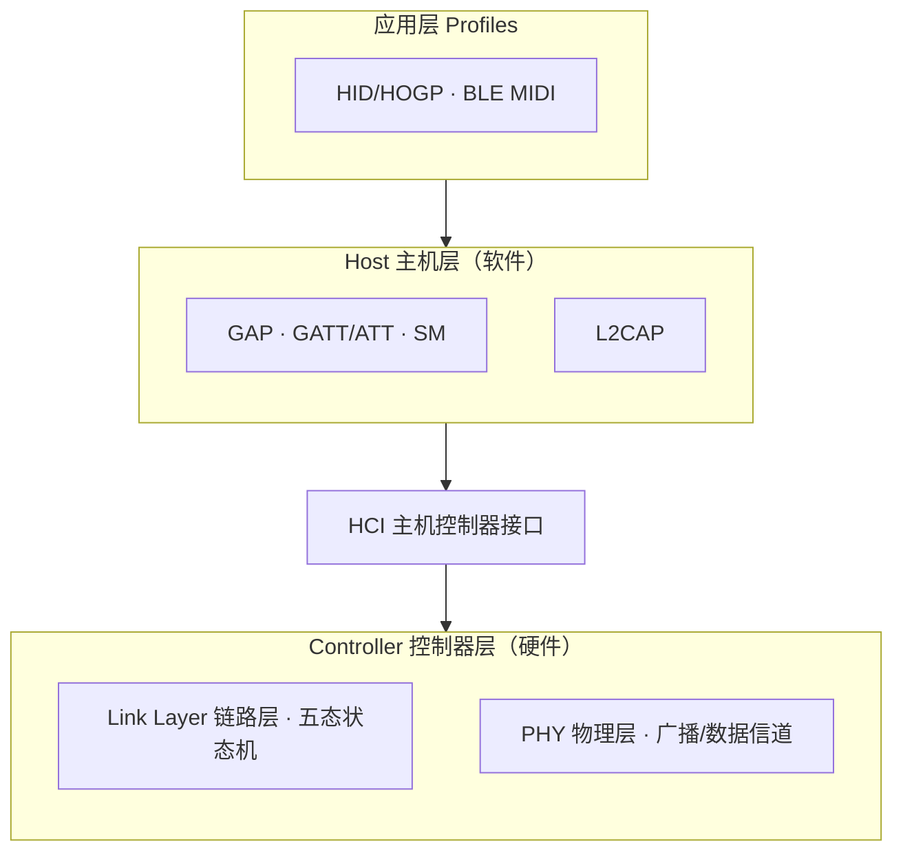
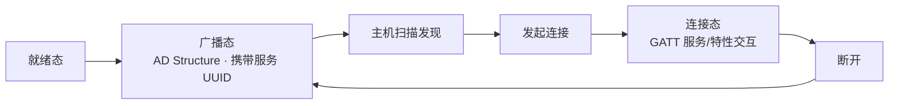

## 一句话总览

BLE 设备以「**广播发现 → 连接建立 → GATT 交互 → 断开重连**」的闭环运转，每个环节恰好落在协议栈的特定层上——越底层越关心"怎么传"（信道、状态机），越上层越关心"传什么"（服务、特性、Profile）。

## 图 1：协议栈分层地图（空间骨架）

## 图 2：生命周期（时间主线）

## 阶段 × 协议层 × 概念页

| 生命周期阶段 | 核心机制 | 协议层 | 概念页 |
|---|---|---|---|
| 发现 | AD Structure 组织、广播/扫描响应 | PHY + Link Layer | [[BLE广播]] |
| 连接 | 就绪/广播/扫描/发起/链接五态切换 | Link Layer | [[BLE状态机]] |
| 交互 | 服务/特性、Read/Write/Notify/Indication | ATT/GATT | [[GATT服务]] |
| 能力表达 | 广播指定 UUID + GATT 对应服务/特性 | 应用层 Profile | [[HID协议]] / [[蓝牙MIDI协议]] |
| 架构底座 | Host/Controller 分层、双模 | 全栈 | [[蓝牙协议栈]] |

## 关键要点

- **广播是"名片"**：可用数据仅 31 字节，装不下就放进扫描响应；携带的**服务 UUID 是"我能干什么"的能力标签**，主机据此决定是否发起连接。
- **断开后必须重新广播**：断开连接设备回到就绪态，只有再次 `gap_advertise` 才重新进入广播态——"可被发现"是主动行为，不是默认状态。
- **GATT 是唯一数据通道**：连接后的所有数据交换都走服务/特性；权限在创建特性时定死（未开 Write 就不能写入、未开 Notify 就不能推送）。
- **Profile 是同构的**：[[HID协议]] 与 [[蓝牙MIDI协议]] 本质相同——都是「广播指定 UUID + GATT 实现对应服务/特性」两个条件，差异只在 UUID 与数据格式约定。
- **分层对应关系**：广播/状态机（LL/PHY）解决"能不能连"，GATT 解决"怎么传数据"，Profile 解决"传什么、代表什么设备"。

## 关联连接
- [[低功耗蓝牙]] — 主题实体
- [[BLE广播]] / [[BLE状态机]] / [[GATT服务]] / [[蓝牙协议栈]] — 机制与架构
- [[HID协议]] / [[蓝牙MIDI协议]] — 应用 Profile 实例
- [[ESP32]] / [[MicroPython]] / [[nRFConnect]] — 实现平台与调试工具
- [[摘要-低功耗蓝牙-广播数据分析]] / [[摘要-低功耗蓝牙-状态切换]] / [[摘要-低功耗蓝牙-服务与特性]] / [[摘要-低功耗蓝牙-midi]] / [[摘要-低功耗蓝牙-hid]] — 来源
