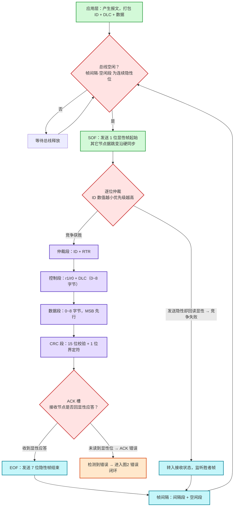
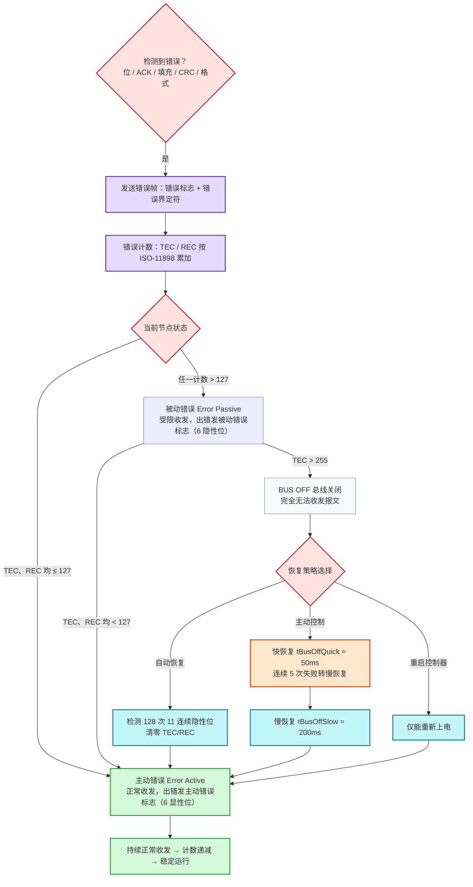

# 综合：CAN 总线运行逻辑

**一句话总览**：CAN 是一根**无时钟线**的异步广播总线——所有节点先在 [[CAN位时序]] 层面把每一位"对齐"好（地基），谁要发数据就竞争总线，靠 ID 在 [[CAN仲裁机制]] 里逐位决出胜者；胜者按 [[CAN数据帧]] 格式把数据播给全网并等待 ACK 确认；一旦出错，[[CAN错误帧]] 通报、[[CAN错误计数器]] 记账、[[CAN节点状态]] 状态机自愈，严重时 BUS OFF 隔离再按 [[BUS OFF恢复策略]] 恢复。下面两张图分别串起**正常路径**与**错误闭环**。

## 地基：位时序让"无时钟"总线可同步

CAN 没有时钟线，同步靠**每个数据位**的微观结构：一个位被拆成 SS 同步段、PTS 传播段、PBS1/PBS2 相位缓冲段，最小单位 Tq，一位置 8~25 个 Tq；采样点放在 PBS1 与 PBS2 之间。所有节点约定"1 个 Tq 多长 + 每位置几个 Tq"，波特率即由此确定。这是整个运行逻辑的**虚拟时钟地基**——仲裁的逐位比较、帧各段的采样判断，全部建立在这套位时序上。详见 [[CAN位时序]]。

## 图1：一帧数据报文的生命周期（正常路径）

> 要点：仲裁是"**显性覆盖隐性**"的物理法则——发隐性位者回读显性即败，ID 数值小者胜；数据帧每个环节都可能被 [[CAN错误帧]] 的检测逻辑打断（位错误、填充错误、CRC 错误、格式错误、ACK 错误），一旦出错整帧作废、转入图2。成功路径上，**发送方靠 ACK 显性位得到"有人收到了"的确认**，与 I2C 的应答思想同源。

## 帧类型速览

| 帧类型 | 何时使用 | 结构要点 | 关联页面 |
| --- | --- | --- | --- |
| **数据帧** | 承载实际数据（正常通信主体） | SOF + 仲裁段 + 控制段 + 数据段 + CRC + ACK + EOF | [[CAN数据帧]] |
| **远程帧** | 请求其它节点回传数据 | 与数据帧同构但**无数据段**，靠 RTR 位区分 | [[CAN远程帧]] |
| **错误帧** | 检测到错误时通报全网 | 错误标志（主动 6 显性 / 被动 6 隐性）+ 界定符（8 隐性） | [[CAN错误帧]] |
| **过载帧** | 总线负载过大、请求暂停发送 | 过载标志（6 显性 + 0~6 位重叠）+ 界定符（8 隐性） | [[CAN过载帧]] |
| **帧间隔** | 分隔两个连续帧 | 间隔段 + 空闲段（被动错误节点多插 8 位暂停段） | [[CAN帧间隔]] |

## 图2：错误闭环——检测 → 计数 → 状态机 → 恢复

> 要点：错误管理是"**快速积累、缓慢修复**"——严重错误（错误标志期间的位错误、连续显性位）计数 +8，成功收发才 -1；计数驱动状态机从主动错误滑向被动错误，TEC 破 255 即 BUS OFF，把故障节点**隔离**出网络（防止拖垮全网），再由恢复策略拉回。诊断侧：连续 8 次 BUS OFF 无成功发送才记录 DTC，且 BUS OFF 期间只存 BUS OFF 码、不判其它节点丢失（节点已收不到总线报文）。

## 运行逻辑的五个关键词

1. **广播**：所有节点收到所有有效帧，靠 ID 过滤只取关心的报文（[[CAN仲裁机制]]）；
2. **仲裁**：无地址、无主从，谁的重要（ID 小）谁先发，扩展性由此而来；
3. **确认**：发送方必须读到 ACK 显性位才算"有人收到"，否则触发错误（[[CAN数据帧]]）；
4. **自愈**：错误帧 + 错误计数器让故障"记在账上"，状态机自动降级（[[CAN节点状态]]）；
5. **隔离**：BUS OFF 把病态节点踢出总线，避免错误风暴扩散到全网（[[BUS OFF恢复策略]]）。

## 关联连接
- [[CAN]] — 所属协议实体
- [[CAN位时序]] — 地基：无时钟同步与波特率
- [[CAN仲裁机制]] — 总线访问控制
- [[CAN数据帧]] / [[CAN远程帧]] — 帧传输主体
- [[CAN错误帧]] / [[CAN过载帧]] / [[CAN帧间隔]] — 帧间与异常帧
- [[CAN错误计数器]] / [[CAN节点状态]] / [[BUS OFF恢复策略]] — 错误管理闭环
- [[摘要-can-位时序与数据帧]] / [[摘要-can-帧类型与帧间隔]] / [[摘要-can-bus-off]] — 来源
