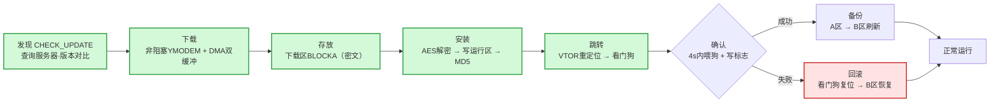

# 综合：OTA 主线导航（MOC）

**一句话总览**：OTA 升级是一条"**发现 → 下载 → 存放 → 安装 → 跳转 → 确认 → 备份 → 回滚**"的完整链路，由 **App（准备方）+ [[Bootloader]]（安装方）** 两条职责链协作完成。本页是 OTA 主线的**入口导航**，组织全部相关页面、指明阅读路径与页间分工。

## 主线生命周期

> 每个环节的权威页面见下方「页面地图」；完整可视化见 [[综合-智能手表OTA全流程]] 三张 mermaid 图。

## 页面地图（按角色分层）

| 角色 | 页面 | 职责 |
| --- | --- | --- |
| **总览 / 入口** | [[综合-智能手表OTA全流程]] | 全流程三图 + 控制权交接 + App 加载/存放/备份速查（**最全**） |
| | [[OTA升级]] | 通用概念 + App/Bootloader 阶段 + **发现升级** + 知识冲突 |
| **机制页** | [[BootManager状态机]] | Bootloader 侧安装状态调度（权威状态图） |
| | [[Bootloader]] | 安装执行者（实体机制 + 源码细节） |
| | [[分区策略]] | 存放地基（为什么分区 / 单区-A/B-三区模型） |
| | [[看门狗]] | 跳转确认 + 线程级监护 |
| | [[完整性校验方案]] | MD5 校验方案 A/B/C |
| | [[固件保护]] | 威胁模型驱动的安全纵深 |
| **支撑页** | [[YMODEM]] | 下载传输协议 |
| | [[AES]] / [[CRC]] / [[MD5]] / [[哈希函数]] | 加解密与完整性校验 |
| | [[DMA双缓冲]] / [[消息队列]] | 下载接收流水线 |
| **硬件页** | [[W25Q64]] / [[加密芯片]] / [[Keros]] / [[NRF52840]] / [[STM32]] | 物理载体与芯片 |
| **来源** | [[摘要-ota无感升级]] / [[摘要-ota面试整理]] / [[摘要-ota-md5校验]] | 原始素材摘要 |

## 阅读路径

| 目的 | 推荐路径 |
| --- | --- |
| **快速理解 OTA** | [[综合-智能手表OTA全流程]] → [[OTA升级]] |
| **深入安装机制** | [[BootManager状态机]] → [[Bootloader]] → [[分区策略]] → [[看门狗]] |
| **安全与校验** | [[固件保护]] → [[完整性校验方案]] → [[AES]] / [[MD5]] |
| **参考工程落地** | [[综合-智能手表OTA全流程]]「案例实现」→ 硬件实体页 |
| **源头溯源** | 三个摘要 → raw 原始文档 |

## 页间分工（避免重复困惑）

同一流程在三个页面各有侧重，**层不同、内容不重复**：

- **[[OTA升级]]**（概念层）：通用机制总览 + 「知识冲突」区（"两套描述该信哪套"的裁判）；
- **[[综合-智能手表OTA全流程]]**（全景层）：流程可视化（三图）+ 控制权交接 + 加载/存放/备份速查 + 案例；
- **[[Bootloader]]**（实体层）：Bootloader 这一实体的机制、源码实现细节与具体项目实例。

## 已知缺口（追踪清单）

| 缺口 | 状态 |
| --- | --- |
| **发现升级（CHECK_UPDATE）**：版本对比机制 | ✅ 已补入 [[OTA升级]] |
| 升级策略细节（低速/高速下载策略的具体算法） | ⬜ 待补（当前仅图1 概览） |
| 多版本管理 / 版本服务器协议（HTTP/MQTT 查询实现） | ⬜ 待补（库内未展开） |

> 追踪原则：缺口在 [[log.md]] 的 query/sync 记录中可见，补齐后在此勾销。

## 关联连接
- [[综合-智能手表OTA全流程]] — 主线全景（最全入口）
- [[OTA升级]] — 概念总览 + 发现升级
- [[BootManager状态机]] — 安装状态调度
- [[Bootloader]] — 安装执行者
- [[分区策略]] / [[固件保护]] / [[看门狗]] / [[完整性校验方案]] — 机制支撑
- [[YMODEM]] / [[AES]] / [[CRC]] / [[MD5]] / [[DMA双缓冲]] — 技术支撑
- [[摘要-ota无感升级]] / [[摘要-ota面试整理]] / [[摘要-ota-md5校验]] — 来源
