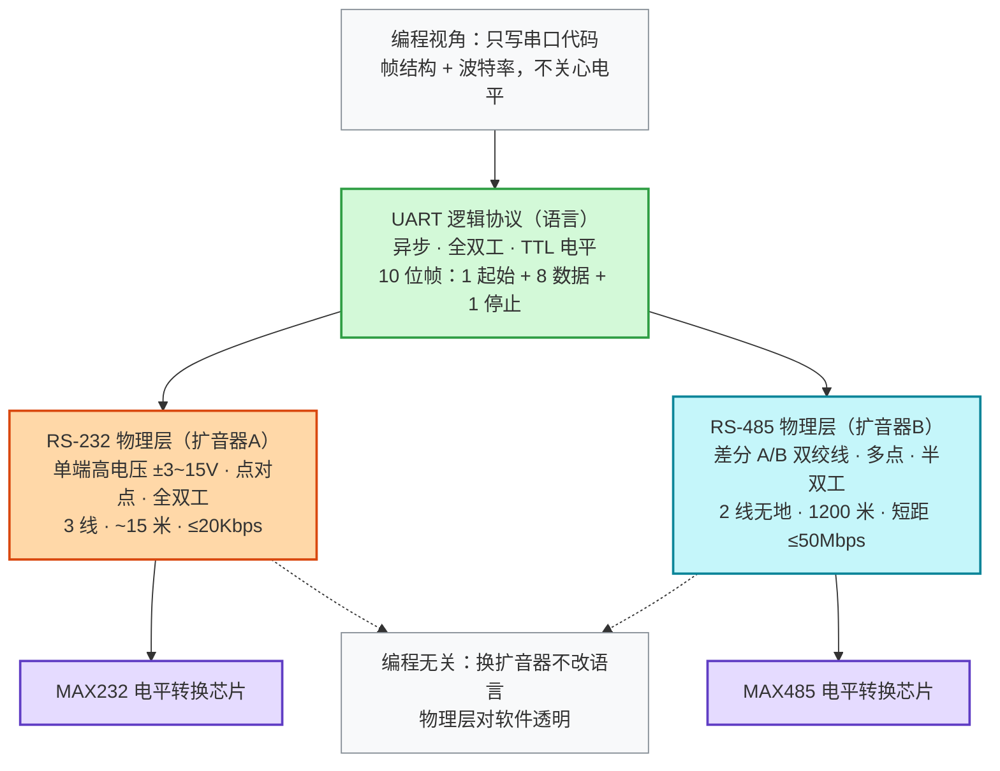

# 综合：串口协议本质区别

**一句话总览**：串口（[[串口]]）是**逻辑协议**（"语言"），RS-232 / RS-485 只是它的**物理层标准**（"扩音器"）——只改电平怎么走，不改数据怎么组织。三者最本质的区别不在速率与距离，而在**层次归属**；RS-232 与 RS-485 之间的本质区别则是**单端点对点高电压** vs **差分多点远距离**——两条完全不同的抗干扰路线。

## 地基：串口语言先定两件事

UART 是异步串行通信，无时钟线，收发双方靠帧内起始/停止位自同步，因此通信前必须先约定（见 [[串口]]）：

- **帧格式**：最常见 10 位帧——1 起始位（低电平）+ 8 数据位（恰好一个字节，256 种组合）+ 1 停止位（高电平），另有 7/5 位数据位变体；
- **波特率**：如 9600 表示每秒传输 9600 个高低电平；双方必须同速，否则解码全错。

电平上采用 TTL 逻辑（高≥2.4V、低≤0.4V，通常视为 5V/0V），抗干扰弱、距离一般限 1 米内。

## 图1：同一个"语言"，两套"扩音器"

> 关键：RS-232 与 RS-485 **不是通信协议，而是物理层标准**（见 [[协议分层]]）——同一套 UART 语言可搭不同"扩音器"，换物理层不改协议代码。RS-232 像**有线的对讲机**（声音大，但只两人通话、距离近）；RS-485 像**专业的公共广播系统**（在广阔嘈杂的工业现场让多个设备广播）。

## 第一层本质：串口 vs RS-232/RS-485（逻辑层 vs 物理层）

| 层面 | 串口 UART | RS-232 / RS-485 |
| --- | --- | --- |
| 身份 | 逻辑协议（语言） | 物理层标准（扩音器） |
| 定义内容 | 数据帧结构、波特率 | 电信号怎么传输（电平标准） |
| 对编程影响 | 直接面对 | 几乎无影响（只换收发器芯片） |
| 类比 | "语言" | "扩音器" |

## 第二层本质：RS-232 vs RS-485（单端 vs 差分）

| 维度 | 串口 UART（TTL） | RS-232 | RS-485 |
| --- | --- | --- | --- |
| **层次** | 逻辑协议 | 物理层 | 物理层 |
| **电平** | TTL：高≥2.4V、低≤0.4V（常视为 5V/0V） | 单端非平衡 ±3V~±15V | 差分，A/B 两线电压差 ±200mV |
| **线数** | TX / RX / GND | 3 线（TX/RX/GND） | 2 线双绞线，**无需地线** |
| **收发模式** | 全双工 | 全双工 | 半双工（两线制） |
| **组网** | 点对点 | 点对点 | 一主多从多点 |
| **距离** | 约 1 米内 | 约 15 米 | 可达 1200 米 |
| **速率上限** | 取决于约定 | 20Kbps（19200 波特） | 短距可达 50Mbps |
| **抗干扰** | 弱 | 一般（电平摆幅近 20V 留裕量） | 极强（共模抵消） |

> 注：RS-485 极性按官方标准定义为 V_A−V_B > +200mV 为逻辑 0、< −200mV 为逻辑 1；各厂商对 A/B 引脚命名不统一，实际接线以器件手册为准。详见 [[RS-485]]、[[差分信号]]。

## 两条抗干扰路线的根本分歧

- **RS-232** 靠**加大电压摆幅**抗干扰：高低电平差近 20V，即使某位被干扰仍有很大判别裕量——代价是只能点对点、速率上不去；
- **RS-485** 靠**差分 + 双绞线**抗干扰：信号是两线之差，外部干扰同时叠加两线、差值不变，天然抵消（见 [[差分信号]]）——所以能跑远、跑快、挂多机。

## 选型速查

| 需求 | 选择 |
| --- | --- |
| 板内 / 1 米内、芯片间 | 直接 TTL 串口 |
| 点对点、十几米、全双工 | MAX232 转 RS-232 |
| 工业现场、远距离、一主多从 | MAX485 转 RS-485 |

## 关联连接
- [[串口]] — 逻辑协议层（UART，语言）
- [[RS-232]] — 点对点单端高电压物理层
- [[RS-485]] — 多点差分物理层
- [[协议分层]] — "语言与扩音器"的分层思想
- [[差分信号]] — RS-485 的传输机理
- [[摘要-串口232-485]] / [[摘要-串口协议]] / [[摘要-串口环形缓冲]] — 来源
- [[I2C]] / [[SPI]] / [[CAN]] — 其它总线在体系中的平行位置
