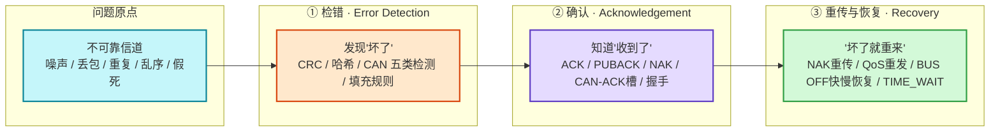

# 综合：可靠传输的通用工具箱

**一句话总览**：[[TCP]]、[[MQTT]]、[[YMODEM]]、[[CAN]]、[[Modbus]] 看似迥异，但全部诞生于同一个问题——**在不可靠的信道上做可靠传输**。它们的解法不是各自发明，而是反复使用同一套**三件套工具箱**：**① 检错**（发现"坏了"）→ **② 确认**（知道"收到了"）→ **③ 重传/恢复**（"坏了就重来"）。不同协议只是在这三件工具里，按自身场景挑拣组合、分配成本。看懂这套骨架，就能在一小时里读透任何一种"可靠协议"。

## 问题原点：不可靠信道到底不可靠在哪

任何物理信道都会把**语义正确的数据**弄坏。常见五种故障模式，决定了工具箱需要哪些工具：

| 故障模式 | 含义 | 触发场景 |
| --- | --- | --- |
| **比特翻转 / 噪声** | 0 变 1、1 变 0 | 电磁干扰、长走线、[[RS-485]] 双绞线外噪声 |
| **丢包** | 数据发出但对方没收到 | 缓冲溢出、冲突、信道超时 |
| **重复** | 同一份数据到达两次 | 确认丢失后盲目重发 |
| **乱序** | 先发的后到 | 多路径路由（TCP/IP 层常见） |
| **假死** | 连接双方仍在但互不知情 | 断电、链路静默、NAT 超时 |

可靠传输 = 用工具把以上故障的影响降到业务可接受的程度。**注意"可接受"三字**——可靠性是有成本的，后面会看到选型阶梯。

## 工具箱总览：同一骨架，四个协议的排列组合

三件工具各解决一层故障：检错负责"发现"，确认负责"对齐认知"，重传/恢复负责"补救"。**检错是后两件的前置条件**——不先发现坏，就没必要重传；不确认收到，重传就无从谈起。下表把四个协议的对应实现对齐摆放：

| 工具 | [[TCP]] | [[MQTT]] | [[YMODEM]] | [[CAN]] |
| --- | --- | --- | --- | --- |
| **① 检错** | 连接建立时的握手语义（防迟到旧包） | —（依赖 TCP 层） | 每帧 **[[CRC]]-16** 校验 | **五类错误检测**：位 / ACK / 填充 / CRC / 格式 |
| **② 确认** | 三次握手 SYN/ACK；挥手 FIN/ACK | QoS1 **PUBACK**；QoS2 **PUBREC/PUBREL/PUBCOMP** 四步 | **ACK** / **NAK**（请求重传） | 数据帧 **ACK 槽**（发送方必须读到显性应答位） |
| **③ 重传/恢复** | 收不到 ACK 不建立连接；**TIME_WAIT** 兜底最后 ACK | QoS1/2 **超时重发**（可能重复） | NAK 触发**断帧重传** | **BUS OFF 快/慢恢复** + 128 次隐性位自动恢复 |

> 读表要点：同一根骨架，**每层在不同协议里由不同角色承载**——TCP 的确认是"连接级"的（建连/断连语义），MQTT 是"消息级"的（QoS 投递保证），YMODEM 是"包级"的（逐帧 ACK/NAK），CAN 是"硬件级"的（发送时回读总线）。越往下层，确认越廉价、越快；越往上层，语义越完整、代价越高。

## 工具①：检错——只负责"发现"，不负责"修复"

检错的目标是**把"不知道有没有坏"变成"知道坏了"**。库内三种检错手段，能力逐级递进：

| 手段 | 检测对象 | 能力边界 | 代表场景 |
| --- | --- | --- | --- |
| **[[CRC]]** | **意外**错误（噪声、位翻转） | 检出所有奇数位错误与 ≤ 多项式阶数的突发错误；**无防篡改能力**（攻击者可重算） | [[YMODEM]] 每帧 CRC-16、[[Modbus]] 帧尾 CRC-16、CAN 的 CRC 段 |
| **[[哈希函数]]（[[MD5]]/SHA-256）** | 意外 + **恶意篡改** | 单向、抗碰撞，校验值不可伪造；MD5 已被攻破，防伪应升级 SHA-256 | OTA 固件整体完整性终检 |
| **CAN 五类检测** | 总线上的物理层/协议层错误 | 位错误（发送时回读）、ACK 错误、填充错误（6 连续同极性）、CRC 错误、格式错误 | [[CAN错误帧]] |

**关键认知：检错是"过滤器"而非"修复器"。** CRC 发现一帧坏了，它不会自己修好——而是把"这一帧作废"这个事实交给下游，由确认与重传机制去补救。检错能力越强（CRC → 哈希 → 签名），成本越高（计算量、校验位长度），但防护对象也从"噪声"升级到"恶意攻击"（见 [[信息安全目标]]）。

## 工具②：确认——把"发了"变成"收到了"

确认解决**认知不对称**：发送方无法直接知道对方是否收到，只能靠对方回话。库内的确认有四种形态：

- **连接级确认（握手）**：[[三次握手]] 用 SYN → SYN+ACK → ACK 三次往返，让双方都确认"我能收到你、你也能收到我"。**为什么必须三次而非两次**——防止网络中滞留的迟到旧 SYN 让服务端误建连接：只有两次握手时，服务端收到旧 SYN 会误以为新连接并傻等数据，而客户端根本不知道。第三次 ACK 是"客户端知道服务端知道"的最后一块拼图。
- **消息级确认（协议 ACK）**：[[MQTT服务质量]] QoS1 收方回 PUBACK，发送方超时未确认则重发（→ 可能重复）；QoS2 用 PUBREC/PUBREL/PUBCOMP 四步握手保证"恰好一次"（→ 不丢不重，代价最大）。
- **包级确认（逐帧 ACK/NAK）**：[[YMODEM]] 接收方每收一帧回 ACK，发现 CRC 错误回 NAK 请求重发；收方发 `'C'` 请求 CRC 模式、发 EOT 表示文件结束，是一个"带确认握手"的完整会话。
- **硬件级确认（总线回读）**：CAN 发送方在 ACK 槽必须读到**显性应答位**才算"有人收到"（见 [[CAN数据帧]]）；读不到即触发 **ACK 错误**，进入错误闭环（[[CAN错误帧]]）。这是最廉价的确认——零额外报文，靠物理层"线与"完成。

> **确认的代价是往返（RTT）**：每多一层确认，吞吐就被"发出去→等回来"的往返钳制一次。这正是为什么高频遥测不用确认（[[UDP]] 无连接、MQTT QoS 0 即发即弃），而命令下发必须确认。

## 工具③：重传与恢复——"坏了就重来"

- **包级重传**：[[YMODEM]] 的 NAK → 重发当前帧，即"**断帧重传**"（协议原生能力）；注意与"断点续传"（整个会话中断后从断点继续）区分——后者不是 YMODEM 原生能力（见 [[OTA升级]] 冲突辨析）。
- **消息级重发**：MQTT QoS1/2 超时重发。**重传的代价是重复**——接收方必须**幂等**（重复投递无副作用），否则命令被重复执行。这是 QoS 档位选择的隐含前提。
- **连接级恢复**：[[四次挥手]] 的客户端 **TIME_WAIT 超时等待**——若最后一个 ACK 丢失，服务端会重发 FIN，客户端在等待期内能响应重发的 FIN，从而让服务端可靠完成关闭。**兜底思想**：不确定时宁可多等，也不让对端卡死。
- **总线级自愈**：CAN 的错误闭环是工具箱在**系统级**最完整的一次演绎——错误帧通报 → 错误计数器记账（[[CAN错误计数器]]）→ 节点状态机降级（[[CAN节点状态]]）→ 严重时 **BUS OFF 隔离**（[[BUS OFF恢复策略]]）→ 快恢复（~50ms）连续失败转慢恢复（~200ms）。它把"重传"扩展成了"降级 + 隔离 + 回归"的自愈生态。
- **执行级恢复（旁支）**：当 CPU 本身卡死时，通信层的重传无能为力，这时用 [[看门狗]] 强复位把执行流拉回正轨——**恢复的对象从"数据"升级到"执行"**，是工具箱在嵌入式系统层的最后一层兜底。

## 选型决策：可靠性是买来的，别超买

所有可靠性都标价。选型不是"越可靠越好"，而是"**在业务容忍度内选最便宜的一档**"：

| 业务场景 | 容忍度 | 推荐组合 | 理由 |
| --- | --- | --- | --- |
| 传感器高频遥测 | 可丢不可卡 | 只检错（QoS 0 / [[UDP]]） | 丢一帧无感，确认反而拖慢吞吐 |
| 命令下发 | 可重不可丢 | 确认 + 重传（QoS 1 / TCP），接收端幂等 | 重复执行可去重，丢失后果严重 |
| 计费 / 关键控制 | 不丢不重 | 恰好一次（QoS 2）或应用层事务 | 重复与丢失都不可接受，接受最高握手开销 |
| 文件 / 固件传输 | 缺一不可 | 逐帧 CRC + ACK + 断帧重传（YMODEM），整体哈希终检（[[完整性校验方案]]） | 多级校验：帧级防传输损坏，文件级防篡改/不完整 |
| 汽车总线控制 | 毫秒级实时 | 硬件级检错 + 状态机自愈（CAN） | 实时性容不下软件确认往返，靠物理层低成本自愈 |

## 一个测试题：如果我要设计一个可靠协议

把工具箱倒过来用即可：**① 给数据帧加校验段（CRC 起步）；② 定义 ACK/NAK 语义（逐帧 or 批量）；③ 规定重传策略（超时多长、最多几次、是否退避）；④ 想清楚重复投递时接收方怎么幂等；⑤ 极端失败时怎么隔离与恢复。** —— 你会发现，你"设计"出来的东西和 YMODEM / Modbus / TCP 长得很像。这不是巧合，而是可靠传输只有这一条成熟路径。

## 关联连接
- [[TCP]] / [[三次握手]] / [[四次挥手]] — 连接级确认与恢复
- [[UDP]] — 无连接对照组（不确认不重传）
- [[MQTT服务质量]] — 消息级投递保证的三档阶梯
- [[YMODEM]] / [[CRC]] — 包级检错 + 逐帧重传
- [[哈希函数]] / [[MD5]] / [[完整性校验方案]] — 文件级完整性终检
- [[CAN错误帧]] / [[CAN错误计数器]] / [[CAN节点状态]] / [[BUS OFF恢复策略]] — 总线级自愈闭环
- [[Modbus报文结构]] — 帧尾 CRC-16 检错
- [[看门狗]] — 执行级恢复（系统层兜底）
- [[信息安全目标]] — 检错 → 完整性的上位安全框架
- [[综合-can运行逻辑]] — 三件套在 CAN 上的完整演绎
