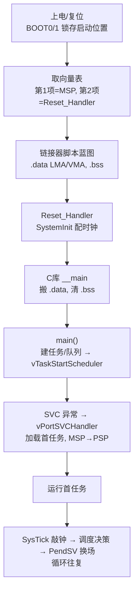

# 单片机从启动到 OS 到任务切换的完整流程

## 核心结论

这条链路的本质是**控制权的逐级移交**：**硬件 → C 运行时 → 用户代码 → RTOS**，每一级只做好自己那一件事。整条链在 [[启动流程]] 中被总结为七阶段，运行期由 [[任务上下文切换]] 驱动。

## 阶段 0-2：硬件启动

- **① 硬件自举**：上电复位后硬件锁存 BOOT0/BOOT1 引脚电平，决定把哪块存储器映射到启动地址 `0x00000000`。常见配置为主 Flash（物理地址 `0x08000000`），见 [[STM32]]。
- **② 内核复位 + 中断向量表**：CPU 从向量表取第 1 项作**主堆栈指针 MSP**、第 2 项作 **Reset_Handler** 入口跳转。向量表可经 VTOR 寄存器运行时重定位（自定义 [[Bootloader]] 的关键）。

## 阶段 3-5：建立 C 运行环境

- **③ 链接器脚本（蓝图）**：`.data` 段有**双地址**——LMA（加载地址，Flash 初值仓库）+ VMA（运行地址，RAM 新家）；`.bss` 只在 RAM 预留空地；另定堆栈位置。
- **④ Reset_Handler（汇编桥梁）**：`SystemInit()` 配时钟/使能 FPU，再跳转 C 库入口 `__main`。
- **⑤ C 库 `__main`（搬家公司）**：`memcpy` 搬运 `.data` 到 RAM、`memset` 清零 `.bss`，然后才调用 `main()`。**C 全局变量此时才可用**。

## 阶段 6：main() 搭建 OS 舞台

初始化外设 → 用 `xTaskCreate` / `xQueueCreate` 创建任务和队列等 OS 对象 → 调用 `vTaskStartScheduler()`（**不返回**）。控制权从此交给 [[FreeRTOS]]。

## 阶段 7：OS 接管（首任务登台）

1. 配置 **SysTick** 心跳；
2. 触发 **SVC** 异常进入处理器模式；
3. `vPortSVCHandler` 加载首任务上下文，栈指针从 **MSP 切到 PSP**；
4. 返回线程模式运行首个任务。

此后日常任务切换不再用 SVC，而是由 **SysTick → PendSV** 驱动。

## 运行期：任务上下文切换

[[任务上下文切换]] 按"舞台剧"模式循环——**职责分离**的协作：

| 角色 | 对应机制 | 职责 |
| --- | --- | --- |
| 计时员 | SysTick 中断 `xPortSysTickHandler` | 敲钟报时 |
| 选角导演 | `xTaskIncrementTick` + `vTaskSwitchContext` | 决策"下一个谁上" |
| 舞台监督 | `xPortPendSVHandler` | 保存/恢复寄存器，换场 |

**触发时机**：①时间片耗尽；②更高优先级任务就绪；③主动 `taskYIELD()`。

**切换流程七步**：SysTick 敲钟 → 唤醒到期延迟任务 → 举换角旗 → PendSV 保存旧上下文 → 选新任务 → 恢复新上下文、切 PSP → `bx r14` 运行新任务。选角策略见 [[任务调度]]。

**关键设计**：
- **为什么用 PendSV**：它是可被其他中断抢占的低优先级异常，把切换推迟到所有高优先级中断处理完之后，避免在中断上下文做重操作、保证实时性；
- **Cortex-M 双栈**：MSP（内核/中断用）+ PSP（每个任务独立），换栈运行只需切 PSP 指针。

## 关联连接

- [[启动流程]] — 七阶段机制详解
- [[任务上下文切换]] — 运行期换场机制
- [[任务调度]] — 选角决策策略
- [[FreeRTOS]] — 操作系统主体
- [[STM32]] — 宿主芯片
- [[Bootloader]] — 向量表重定位与自定义引导
- [[摘要-stm32启动流程]] — 阶段 0-7 来源
- [[摘要-freertos任务上下文切换]] — 切换机制来源
