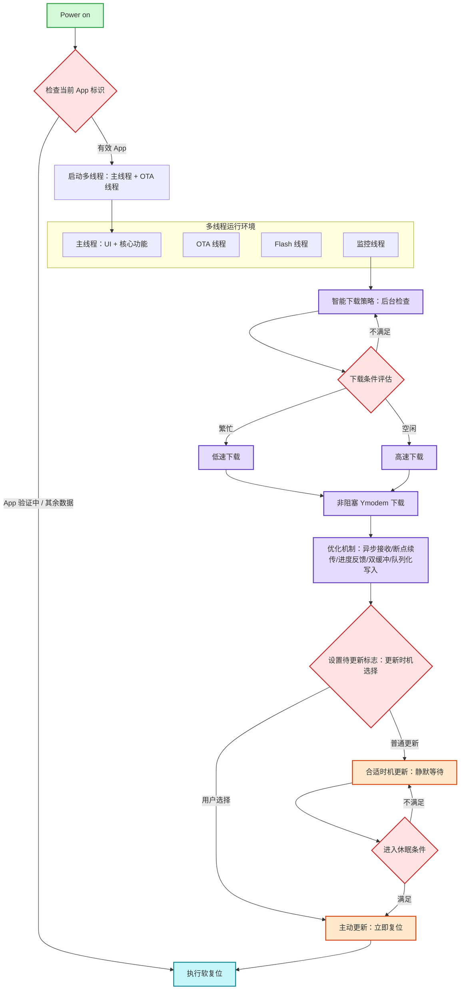
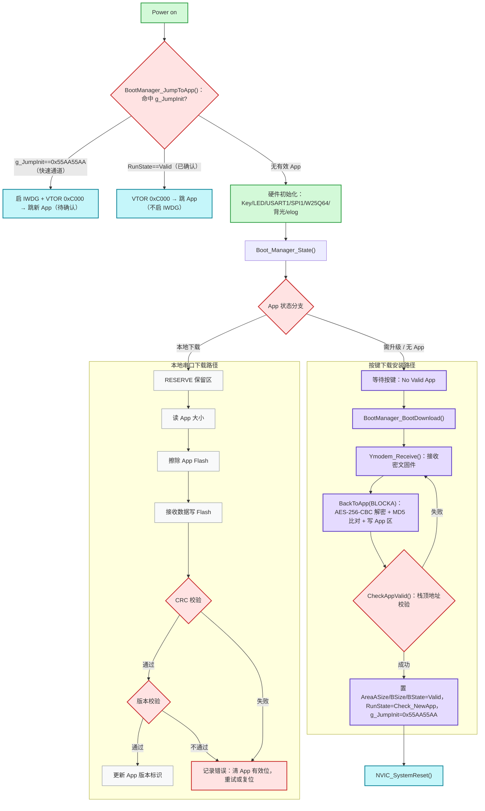
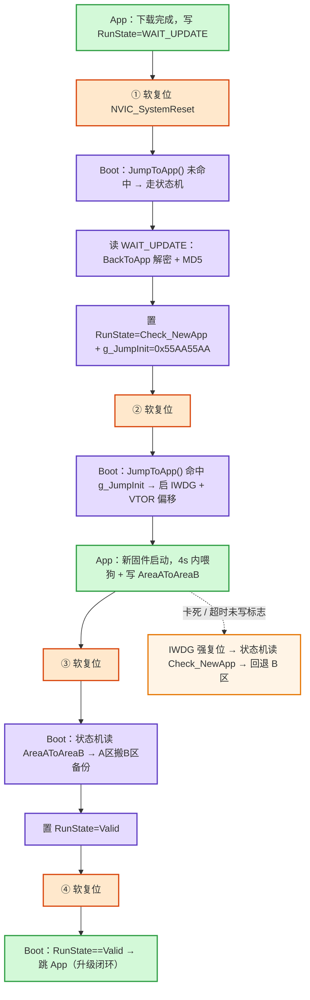

# 综合：智能手表 OTA 全流程

参考工程（STM32F411 智能手表）的 OTA 架构分**两条职责链**：**App 侧负责"准备"**（后台静默下载、置标志、软复位），**Bootloader 侧负责"安装"**（判状态、解密搬运、校验、回滚、跳转）。以下两张独立流程图 + 一张内嵌状态机图构成全貌（状态机唯一权威图位于 [[BootManager状态机]]，此处直接嵌入避免双份维护），细节经参考工程源码校准。另附 **四次复位接力图**（App ↔ Bootloader 控制权交接，见下文），补上两块独立固件之间"复位即交接"的接缝。

## 图1：App 侧无感升级流程（准备阶段）

> 要点：下载条件不满足时循环等待；空闲走高速下载、繁忙走低速；更新时机分**主动**（用户点击立即复位）与**静默**（休眠条件满足才复位，实现"无感"）。优化机制五件套中**断点续传属于 App 下载阶段**（见 [[OTA升级]] 冲突辨析）。

## 图2：Bootloader 主流程全景（入口与两条安装路径）

> 图2 融合了白板旧版（更细的本地下载/失败处理路径）与源码 main.c 主流程。**按键入口**是 Bootloader 的兜底升级通道；本地串口下载（ISP）与 Ymodem/OTA 是并存的三条安装路径。

## 图3：Bootloader 安装状态机（内嵌自 [[BootManager状态机]]）

安装阶段的调度核心是 Bootloader 侧的 `App_RunState` 状态机：五个状态值分派到解密安装、回滚、搬运、恢复或重新下载。**权威状态迁移图位于 [[BootManager状态机]]，此处直接嵌入，保持单一事实来源**：

![[BootManager状态机#状态迁移图]]

> 五个状态：`APP_WAIT_UPDATE / APP_Check_NewApp / APP_AreaAToAreaB / APP_Valid / 其他`。升级失败一律回滚 B 区或清标志，防变砖；状态值与处理函数映射见 [[BootManager状态机]]。

## App ↔ Bootloader 控制权交接：四次复位接力

> 图1、图2 分别画了"App 准备"与"Bootloader 安装"两条职责链，但两块**独立固件之间如何互相让渡控制权**始终未显式表达——本节补上这道接缝。核心一句话：**复位即交接**。App 与 Bootloader 不共享符号、不能互相调函数，任何复位后 CPU 都从 Flash 最低地址的 Bootloader 向量表重新起跑，双方只能靠"复位 + 跨复位存活的信箱"传递控制权与任务指令。

### 为什么软复位后是 Bootloader 在跑（物理地基）

- Cortex-M 上电/复位后固定从 Flash 起始地址取中断向量表：第 1 项 MSP、第 2 项 Reset_Handler（[[启动流程]]）。
- 参考工程中 Bootloader 链接在 Flash 最低地址段，App 在 `0x800C000`——所以**任何复位（上电 / NVIC_SystemReset / IWDG）后先执行的必然是 Bootloader**（[[STM32]]）。
- 因此 App 的"软复位"不是调用 Bootloader，而是**把 CPU 打回 0 点让 Bootloader 重新接管**；Bootloader 跳转 App 则靠置 VTOR 偏移 `0xC000` 后取 App 区 Reset_Handler（[[Bootloader]]）。

### 跨复位存活的"双信箱"

| 信箱 | 载体 | 存活性 | 语义 |
| --- | --- | --- | --- |
| **Flash 标志** `RunState` | 内部 Flash `0x8008000`（Anti 反码镜像） | 复位不丢，长程记忆 | 状态机输入："接下来 Bootloader 做哪个阶段" |
| **SRAM 变量** `g_JumpInit` | `0x2001FFF0`（SRAM 尾） | NVIC 系统复位不清，短程速递 | "本次复位后跳过状态机、直接跳 App" |

### 四次复位接力图

### g_JumpInit 的深层作用：短路 Check_NewApp

安装成功后为何不直接把 `RunState` 置 `Valid`，而要置 `Check_NewApp`？因为状态机的 `Check_NewApp` 分支语义是**回退**（[[BootManager状态机]]）——若走正常状态机，刚装好的新固件会被回退掉。所以：

> `g_JumpInit` = 在状态机**之前**截胡，让 `BootManager_JumpToApp()` 直接跳新 App，把"新固件是否真的能跑"的裁判权交给**新 App 自己（写确认标志）+ 看门狗（超时强复位）**。若新 App 卡死 → IWDG 复位 → 状态机读到 `Check_NewApp` → 回退 B 区（与 [[摘要-ota面试整理]] 2.4 完全一致）。

### 源码确证（Boot_Manager.c 校准）

- **`g_JumpInit` 消费时机**：`BootManager_JumpToApp()` 命中 `0x55AA55AA` 后**立即清零为 `0xFFFFFFFF`**（执行序：先清 → 再 `IWDG_Init` → 再跳转）。因 IWDG 复位同样不清 SRAM，若不消费则 IWDG 复位后再次命中 → 死循环；清零后 IWDG 复位落到 `Check_NewApp → 回退 B 区`，闭环成立。
- **IWDG 只在快速通道启动**：源码仅 `g_JumpInit` 分支调用 `IWDG_Init(IWDG_Prescaler_64,3000)`；`RunState==Valid` 分支直接跳转、**不启动 IWDG**——因为 Valid 意味着 App 已在上一轮升级中通过 4s 确认，日常冷启动无需看门狗兜底。
- **Check_NewApp 注释印证短路语义**：源码注释原文"一般不会进入这里，进入这里说明上一次升级失败，需要回退版本"——正常情况下 `g_JumpInit` 已在状态机前截胡，进入即代表新 App 未确认。

## 关键工程事实（源码校准）

- **存储布局**：App 区 `0x800C000`（Sector 3）、App 标志区 `0x8008000`（Sector 2）、`MAXAPP_SIZE=464KB`；外部 [[W25Q64]] 分 A/B 双区。
- **标志位**：`st_App_Info_t` 四个字段（RunState/AreaASize/AreaBState/AreaBSize），每字段带 **Anti 反码镜像**（`value == ~Anti` 才有效），写入时先擦后写。
- **上电跳转共享变量**：`g_JumpInit @ 0x2001FFF0`（SRAM 尾），软复位不清零——`BootManager_JumpToApp()` 先判它，命中则启动 [[看门狗]]（IWDG）并跳转；**命中即清为 `0xFFFFFFFF`**，且仅此分支启 IWDG（`RunState==Valid` 分支不启）。
- **解密搬运**：`BootManager_BackToApp()` 每 16 字节 AES-256 CBC 解密，应用数据同步算 MD5，尾部 16 字节为期望 MD5，比对一致才算成功（对应 [[完整性校验方案]] 方案A）。
- **回滚**：`Rollback_Backup_Area()` 从 B 区解密恢复；B 区是升级前可运行固件，保障任何时刻有兜底。

## 案例实现：参考工程源码细节

> 本节为**项目级案例**，与上文通用机制分离：图1-3 与控制权交接节讲的是**可迁移逻辑**，这里呈现该参考工程源码里的**具体落地细节**作为例证。非通用知识，仅作案例参考。案例语境：一个智能手表 OTA 参考工程（STM32F411 + NRF52840 + Keros + W25Q64）。

### 分区地图

| 存储 | 区域 | 地址 | 容量 |
| --- | --- | --- | --- |
| 内部 Flash | Bootloader 代码 | `0x08000000`–`0x08007FFF` | 32KB（Sector 0–1） |
| 内部 Flash | App 标志区 | `0x08008000` | 16KB（Sector 2） |
| 内部 Flash | App 运行区 | `0x0800C000`–`0x0807FFFF` | 464KB（Sector 3–7） |
| SRAM | `g_JumpInit`（MYRAM UNINIT 段） | `0x2001FFF0` | 16B |
| 外部 W25Q64 | BLOCKA 下载区 | `0x00000000`–`0x0007FFFF` | 512KB |
| 外部 W25Q64 | BLOCKB 备份区 | `0x00080000`–`0x000FFFFF` | 512KB |

- **`g_JumpInit` 不清零的链接层实现**：链接脚本为其单独划 `MYRAM 0x2001FFF0 UNINIT 0x0000000F` 段，启动代码跳过清零——这是"软复位不清零"的根因。
- **外部 Flash 软件扇区**：4KB 粒度管理，写满擦整扇再按 256B 页写。

### 密钥供应链（KEROS）

- EEPROM Page0 布局：`vector(16) + key(32) + CRC8(1) + CRC8_INV(1)`。
- 读取链路：初始化 → 挑战-应答认证（防芯片替换）→ 读 EEPROM → CRC-8 校验 → key/IV 入 SRAM。
- 密钥不落 MCU Flash。

### 固件格式与解密安装

- 密文包 = 首帧头部(16B) + 应用数据密文 + 尾部 MD5(16B)；头部解密后解析 `app_size`（含尾 MD5）。
- 解密安装：擦除 App 区 → 逐 16B AES-256-CBC 解密（IV 链式）+ MD5Update + 字写 → MD5 比对。

### 传输层实现（Ymodem）

- SOH(128B)/STX(1024B) 包、帧尾 2B CRC16；接收端只做序号校验 + 错误重传（`MAX_ERRORS=5`）。
- 下载密文直接写 BLOCKA，不解密。

### 开发版与量产方案差异

| 维度 | 参考工程开发版源码实况 | 量产方案（[[摘要-ota面试整理]]） |
| --- | --- | --- |
| 签名认证 | 未实现（仅 KEROS 芯片级认证） | OPT Flash 公钥签名验证，未认证不解密 |
| Ymodem CRC | 接收端未计算 CRC16，仅序号+重传 | 逐帧 CRC 校验 + 断帧重传 |
| 版本防回退 | 无版本号比较 | 新固件版本须高于现版本，否则拒绝写入 A 区 |

## 关联连接
- [[BootManager状态机]] — 图3 状态机的完整定义（权威图所在）
- [[OTA升级]] — 概念总览与知识冲突
- [[Bootloader]] — 安装执行者
- [[启动流程]] — 复位向量与 VTOR 重定位（控制权交接的物理地基）
- [[Keros]] / [[W25Q64]] / [[STM32]] / [[NRF52840]] — 硬件实体
- [[AES]] / [[哈希函数]] / [[完整性校验方案]] / [[MD5]] — 加解密与完整性
- [[看门狗]] — 跳转验证
- [[YMODEM]] — 传输协议
- [[摘要-ota无感升级]] / [[摘要-ota面试整理]] / [[摘要-ota-md5校验]] — 来源
