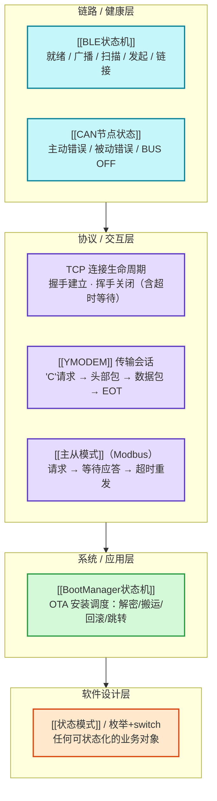

# 综合：状态机，嵌入式世界的第一性原理

**一句话总览**：嵌入式系统的本质是"**一个随时间响应离散事件的实体**"——而任何这类实体，最自然、最可靠的建模方式就是**状态机（Finite State Machine）**。[[BootManager状态机]]（OTA 安装调度）、[[BLE状态机]]（链路层连接）、[[CAN节点状态]]（总线健康）、TCP 的[[三次握手]]/[[四次挥手]]、[[YMODEM]] 的传输会话、[[主从模式]] 的请求-应答，乃至 [[状态模式]]（软件实现）——它们分布在不同层、形态各异，但共享同一副骨架。**看懂这幅骨架，你就看懂了嵌入式里一半的"复杂流程"。**

## 状态机栖息在每一层

> 越往下层状态越"薄"（几个状态、硬件/协议驱动），越往上语义越"厚"（带动作、带失败回滚）。但**不管哪层，状态机的价值都一样**：把"随时间变化的复杂行为"压缩成一张可枚举、可证明的迁移表。

## 通用解剖：状态机永远只有四个要素

任何状态机——无论 OTA 还是 BLE——都由这四件东西构成：

| 要素 | 含义 | 例：[[BootManager状态机]] | 例：[[BLE状态机]] |
| --- | --- | --- | --- |
| **状态集** | 有限个互斥的"处境" | `WAIT_UPDATE / Check_NewApp / AreaAToAreaB / Valid` | 就绪 / 广播 / 扫描 / 发起 / 链接 |
| **事件** | 触发迁移的输入 | 上电读到某个标志值 | 广播启动、连接请求、断开 |
| **迁移表** | 状态 × 事件 → 下一状态 + 动作 | 状态值 → 处理函数 | IRQ 回调 → 状态切换 |
| **状态存储** | 当前状态记在哪 | Flash `App_RunState`（+ Anti 反码镜像） | 链路层内部状态变量 |

**关键：状态存储是状态机的"记忆"，也是最脆弱的部位。** 状态若被意外篡改（Flash 位翻转）或丢失（掉电），状态机就会迁移到错误分支。所以可靠的状态机设计永远包含**状态保护**——这一点在下面各例中反复出现。

## 六种状态机的跨域对照

| 状态机 | 领域 | 状态（示例） | 事件来源 | 迁移驱动 | 失败处理 |
| --- | --- | --- | --- | --- | --- |
| **[[BootManager状态机]]** | OTA 安装 | WAIT_UPDATE → Check_NewApp → AreaAToAreaB → Valid | 上电读 Flash 标志 | **设标志 + 软复位** | 回滚 B 区 / 清标志 |
| **[[BLE状态机]]** | 链路层 | 就绪/广播/扫描/发起/链接 | 广播数据、连接请求、断开 | IRQ 事件回调 | 断开回就绪，须重新广播 |
| **[[CAN节点状态]]** | 总线健康 | 主动错误 → 被动错误 → BUS OFF | TEC/REC 计数越界 | **错误计数驱动** | 降级 → 隔离 → 快/慢恢复 |
| **TCP 连接生命周期** | 网络 | 握手建连（三次）→ 传输 → 挥手关闭（四次） | SYN/FIN/ACK 报文 | 报文到达 | 收不到 ACK 不建连；TIME_WAIT 兜底 |
| **[[YMODEM]] 传输会话** | 文件传输 | 请求CRC模式 → 头部包 → 数据包 → EOT → 结束 | `'C'` / ACK / NAK / EOT | 控制字符 | NAK 重传 / CAN 中止 |
| **[[主从模式]]（[[Modbus]]）** | 工业总线 | 请求 → 等待应答 →（超时）→ 重发/下一条 | 主站轮询 | 请求-应答周期 | 超时重发 / 跳下一条 |

> 读表要点：**"事件来源"和"迁移驱动"各有一类共性**——事件要么来自**异步硬件**（中断、报文、计数越界），要么来自**主动控制**（标志位、轮询）；迁移驱动要么是"**外部事件到达**"（被动响应），要么是"**自身执行完动作后主动换状态**"（主动推进）。BootManager 是后者的极端——它每次动作完都"设标志 + 软复位"，用复位本身当"事件"，把状态机拆成多个启动周期来走。

## 三个跨域洞察

### 洞察一：状态机 = 把"if/switch 杂烩"显式化为可证明的迁移表

没有状态机时，协议处理是"一坨 if 判断当前该干嘛"；有状态机后，行为被压缩成 **状态 × 事件 → 迁移** 的二维表。收益有三个：**非法事件可被忽略/拒绝**（状态机只认合法迁移，天然防呆）；**行为可测试**（状态+事件可枚举穷尽）；**代码可读**（每个状态一个处理函数，而不是嵌套 if）。这正是 [[状态模式]] 与嵌入式"枚举 + switch"两种实现共享的核心价值——后者是前者的朴素形态，状态多、迁移复杂时才值得升级为前者。

### 洞察二：可靠的状态机设计，必然包含"状态保护"与"失败兜底"

状态机把系统的"当前处境"浓缩成一个变量，这个变量就成了**单点**。看看库里成熟的设计怎么保护它：

- **状态值防篡改**：[[BootManager状态机]] 的每个标志存 `value + ~value` 两份，读取时 `value == ~Anti` 才算有效——**Anti 反码镜像**直接对抗 Flash 位翻转误判。
- **状态降级而非崩溃**：[[CAN节点状态]] 把错误计数（TEC/REC）当"健康指针"，越界就主动降级（被动错误 → BUS OFF），把病态节点**隔离**出网络再恢复——状态机本身就是可靠性机制。
- **失败必有回退路径**：BootManager 的每个迁移都定义"成功去哪个状态、失败去哪个状态"（回滚 B 区 / 清标志），保证任何时刻系统都知道"下一步能去哪"，而不是卡死。
- **状态转移的确认语义**：TCP 四次挥手的 **TIME_WAIT** 就是"状态机收尾的可靠性"——不确定最后 ACK 是否送达时，宁可多等也不让对端卡在 LAST_ACK。

### 洞察三：状态迁移的两种驱动，对应两类系统设计

| 驱动类型 | 特征 | 代表 | 设计含意 |
| --- | --- | --- | --- |
| **事件驱动** | 外部异步输入到达 → 被动迁移 | BLE IRQ、TCP 报文、YMODEM 控制字符 | 需要"事件 → 回调/队列"的基础设施（[[消息队列]]、[[中断上半部与下半部]]） |
| **状态推进** | 动作执行完主动换状态 | BootManager 设标志 + 复位、Modbus 请求周期 | 需要"动作 → 结果判定 → 下一状态"的显式调度（[[任务调度]]、超时管理） |

真实系统两者混合：BootManager 的"上电读标志"是事件驱动，而"安装完设标志 + 软复位"是状态推进；CAN 的"错误计数越界"是事件驱动，"BUS OFF 后按恢复策略回归"是状态推进。

## 软件实现：三种落法，按复杂度选

| 实现 | 形式 | 适用 | 代价 |
| --- | --- | --- | --- |
| **枚举 + switch** | `OtaState` + `idle_on_event()` | 状态少（<8）、迁移简单 | 最轻、最直观；状态多时 switch 膨胀 |
| **表驱动** | 迁移表数组 `[state][event] = next_state` | 状态 × 事件 二维关系清晰 | 加一层数据，可配置化 |
| **[[状态模式]]** | Context + State 接口 + ConcreteState | 状态多、每个状态带复杂行为 | 类/结构数量多，嵌入式慎用 |

> 嵌入式默认从"枚举 + switch"起步，只有状态机成长到"每个状态都有独立复杂行为"才考虑状态模式。这与 [[状态模式]] 页面"状态多、迁移复杂时收益明显"的结论一致。

## 一个测试题：串口协议解析器也是状态机

收"不定长帧"（[[定帧]]）时，解析器天然是一个状态机：`空闲 → 收帧头 → 收数据 → 校验(CRC) → 处理/丢弃 → 回空闲`。**帧头定了状态、字节数定了转移、CRC 决定进"处理"还是"丢弃"**。你写的 `switch(state)` 就是状态机；加一个"收到非法字节强制回空闲"就是状态保护。— 看懂这一题，你会在 [[环形缓冲区]]、[[YMODEM]]、[[Modbus报文结构]]、[[MQTT报文结构]] 里反复认出同一个骨架。

## 关联连接
- [[BootManager状态机]] — 系统层状态机的完整案例（含 Anti 镜像与回滚）
- [[BLE状态机]] / [[BLE广播]] — 链路层状态机
- [[CAN节点状态]] / [[CAN错误计数器]] / [[BUS OFF恢复策略]] — 健康状态机 + 错误自愈
- [[三次握手]] / [[四次挥手]] — TCP 连接生命周期状态机
- [[YMODEM]] / [[定帧]] — 传输/解析状态机
- [[主从模式]] / [[Modbus报文结构]] — 请求-应答状态机
- [[状态模式]] / [[策略模式]] — 状态机的软件实现与区别
- [[消息队列]] / [[中断上半部与下半部]] — 事件驱动的输入基础设施
- [[综合-可靠传输工具箱]] — 状态机承载的确认/重传/恢复骨架
