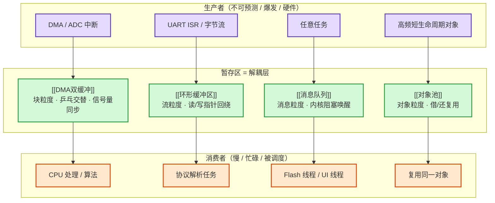

# 综合：生产-消费缓冲的四种形态

**一句话总览**：只要系统里存在"**一方产数据、一方耗数据**"，就必然面临速率不匹配——生产者偶发爆发、消费者被阻塞或忙于别事。嵌入式世界反复使用同一个解耦方案：**在中间插入一块"暂存区"**。[[DMA双缓冲]]、[[环形缓冲区]]、[[消息队列]]、[[对象池]]（以及跨节点的 MQTT 持久会话）就是这块暂存区的四种典型形态。它们不是四个独立知识点，而是**同一个"生产-消费解耦"模式在不同粒度、不同同步方式下的四种实例化**——看懂它们的共同骨架，任何新出现的"缓冲"你都能一眼归类。

## 问题原点：为什么必须加一块中间层

直接让生产者把数据交给消费者，会撞上三个硬问题：

1. **速率不对称**：生产者 1ms 产一批，消费者要 10ms 才处理完——消费者处理期间数据放哪？
2. **阻塞传染**：若生产者必须等消费者处理完才能继续，慢消费者会反过来卡住快生产者（生产端丢数据）或让 CPU 空转等待（[[信号量]] 阻塞）。
3. **时序耦合**：生产者是中断/DMA/网络这种"不可预测"来源时，消费者无法与它同步握手。

暂存区把这三点一起解决：**生产方只管往暂存区写，消费方只管从暂存区读，双方只依赖暂存区的"满/空"状态，彼此不直接握手**。这是缓冲区最本质的价值——**解耦**。

## 四种形态：同一骨架，四个参数不同



四种形态的本质差别只在四个参数：**粒度**（块 / 字节流 / 消息 / 对象）、**满/空时的行为**（阻塞 / 覆盖 / 返回 NULL）、**是否拷贝**、**同步机制**（信号量 / 指针 / 内核 / 标志位）。

| 形态                   | 粒度      | 满 / 空行为            | 拷贝           | 同步机制                    | 典型场景                  |
| -------------------- | ------- | ------------------ | ------------ | ----------------------- | --------------------- |
| **[[DMA双缓冲]]**       | 固定块 A/B | 交替阻塞（双信号量）         | 可零拷贝（隐式半满中断） | 中断 + [[信号量]]            | ADC 采集、DMA 搬运、OTA 下载  |
| **[[环形缓冲区]]**        | 字节流     | 消费慢则覆盖/丢帧（需策略）     | 可零拷贝（原地解包）   | 读/写指针回绕                 | 串口不定长接收、中断日志          |
| **[[消息队列]]**         | 消息（带边界） | 空队消费阻塞 / 满队生产阻塞    | 拷贝入队         | 内核阻塞唤醒（[[任务调度]]）        | ISR→任务交接、DMA→Flash 线程 |
| **[[对象池]]**          | 对象      | 池满返回 NULL          | 无            | 借/还标志                   | 高频短生命周期对象、连接缓冲        |
| **MQTT 持久会话**（跨节点变体） | 消息      | Broker 暂存离线消息，上线即收 | 网络传输         | Broker 存储转发（[[发布订阅模型]]） | 物联网离线订阅者              |

> 读表要点：**粒度越粗、语义越完整，同步机制越重**。双缓冲靠硬件+信号量（最轻）；环形缓冲靠软件指针（无内核参与，最灵活）；消息队列靠内核阻塞唤醒（最安全、有语义）；对象池靠借还标志（针对分配性能而非速率匹配）。MQTT 持久会话把"暂存区"搬到了网络对端，是同一模式在**跨设备尺度**上的延伸。

## 形态①：双缓冲——"乒乓"，专为硬件流水线而生

[[DMA双缓冲]] 用两块固定内存 A/B 交替：DMA 填 A 时 CPU 处理 B，满后互换，**双方各用一块、互不等待**。它的精髓是"**乒乓流水线**"——把"等待对方"的时间重叠成"双方同时干活"。

- **同步靠双信号量**：空内存数 / 满内存数，满>0 才允许消费，空=0 则生产阻塞（[[信号量]]）。
- **隐式 vs 显式**：隐式用一块连续地址 + 半满中断（硬件自动乒乓，ISR 只通知）；显式用两块独立内存（ISR 切目标地址，控制力强但状态复杂）。
- **与 [[解包策略]] 组合**：缓冲方式（隐式/显式）× 解包方式（原地/异地）构成串口驱动 2×2 架构矩阵——原地解包零拷贝但时序敏感，异地解包多一次拷贝但解耦彻底。

## 形态②：环形缓冲——"回绕"，为不定长字节流而生

[[环形缓冲区]] 用一块连续内存 + 读/写指针首尾回绕，模拟 FIFO，**能连续缓存多帧、容忍消费端偶发缓慢**。它是双缓冲在"不定长、连续流"场景的自然升级。

- **空满判断两法**：计数法（count==0 空 / count==size 满，推荐）；指针法（写追读为满，需留空位或标志位）。
- **与 DMA 的两种结合**：硬件环形（Circular DMA 地址自动回绕）vs 软件环形（DMA 写固定数组，ISR 拷贝入逻辑队列）——见 [[DMA]]。
- **与双缓冲的分工**：双缓冲每周期处理**一帧**；环形缓冲**可缓存多帧、攒批处理**。要"一帧一处理"用乒乓，要"攒一批再处理"用环形。

## 形态③：消息队列——"带边界的 FIFO + 阻塞唤醒"，为任务交接而生

[[消息队列]] 在环形缓冲的"容器"之上，加了 RTOS 内核的**阻塞/唤醒语义**：空队消费阻塞、满队生产阻塞，由内核统一管理。它传的是**消息（载荷 + 边界）**而非裸字节流。

- **中断侧是关键场景**：ISR 用 `xQueueSendToBackFromISR()` 等 FromISR API **非阻塞入队**，是 [[中断上半部与下半部]]"中断线程化"的首选交接方式，天然避免 [[优先级反转]]。
- **与信号量的分工**：队列传**数据**，信号量只传**计数**（资源可用性）——需要载荷时必须用队列。
- **与环形缓冲的分工**：环形缓冲只保证"字节安全存取"，队列额外保证"任务间线程安全 + 阻塞唤醒"。裸串口用环形，跨任务必须用队列。

## 形态④：对象池——"借还而非分配"，为高频对象分配而生

[[对象池]] 不是为速率匹配，而是为**分配性能**：预分配一批对象，运行中借/还，**不真正 free**，回收只是把标志置回空闲。`pool_alloc` 池满返回 NULL，`pool_free` 做指针范围校验。性能可比 `malloc/free` 快 10~100 倍、无堆碎片、分配时间确定。

> 注意形态④与前三种的差异：前三种缓冲的是"**数据**"，对象池缓存的是"**对象/资源**"。但在"预分配 + 复用 + 满时明确拒绝"这一点上，它与双缓冲（满则阻塞）、队列（满则阻塞）共享同一套**资源预算思维**——**缓冲容量是设计参数，不是无限资源**。

## 嵌套：真实系统从不单选，而是分层组装

四种形态不是互斥选项，而是**可以嵌套的层**。最典型的证据是 OTA 下载链路：

```
DMA 双缓冲（收数据，块粒度乒乓）
   ↓ 中断
消息队列（把满缓冲地址交给消费线程，消息粒度交接）
   ↓
Flash 线程（消费：擦写 Flash）
```

串口驱动同理：**DMA 双缓冲（硬件层收）→ 环形缓冲（协议层攒帧）→ 消息队列（任务层交接）→ 对象池（连接/缓冲对象复用）**。每一层解决不同尺度的解耦问题——**判断一个系统要几层缓冲，就看它有几个"速率/时序不匹配的接口"**。

## 选型决策：四个问题定形态

| 决策问题 | 答案 → 形态 |
| --- | --- |
| 生产/消费是否同设备？ | 否 → MQTT 持久会话 / Broker 存储转发（跨设备版暂存区） |
| 数据粒度是流还是帧/消息？ | 流 → [[环形缓冲区]]；帧/消息 → [[消息队列]] |
| 是否与硬件 DMA/中断协同？ | 是 → [[DMA双缓冲]]（硬件乒乓 + 信号量） |
| 消费端要"阻塞等数据"语义吗？ | 要 → [[消息队列]]；不要（轮询/攒批）→ [[环形缓冲区]] |
| 对象高频创建销毁、内存抖动？ | 是 → [[对象池]] |

## 一个测试题：1KB 串口数据、每帧 20 字节、ISR 收、慢任务解析

组装答案：**DMA（隐式/显式双缓冲）收字节 → 环形缓冲攒帧（20B/帧）→ 消息队列把"已定帧的数据块地址"交给解析任务 → 解析任务可再用对象池复用帧对象**。你写出来的就是 [[综合-串口协议本质区别]] 与 [[解包策略]] 里描述的标准嵌入式串口架构——这不是某个大神的发明，而是"生产-消费解耦"模式按四个问题机械推导的必然结果。

## 关联连接
- [[DMA双缓冲]] / [[环形缓冲区]] / [[消息队列]] / [[对象池]] — 四种形态本体
- [[信号量]] — 双缓冲/队列的同步机制
- [[解包策略]] — 缓冲 × 解包的 2×2 架构矩阵
- [[中断上半部与下半部]] — ISR 经队列交接的线程化模型
- [[优先级反转]] — 队列避免互斥锁穿透的原因
- [[OTA升级]] — DMA→队列→Flash 线程的分层组装实例
- [[MQTT服务质量]] — 持久会话 = 跨节点的"缓冲"
- [[FreeRTOS堆内存管理]] — 对象池 vs 堆分配的对比
- [[并发与并行]] — 缓冲让生产/消费并发/并行的基础
